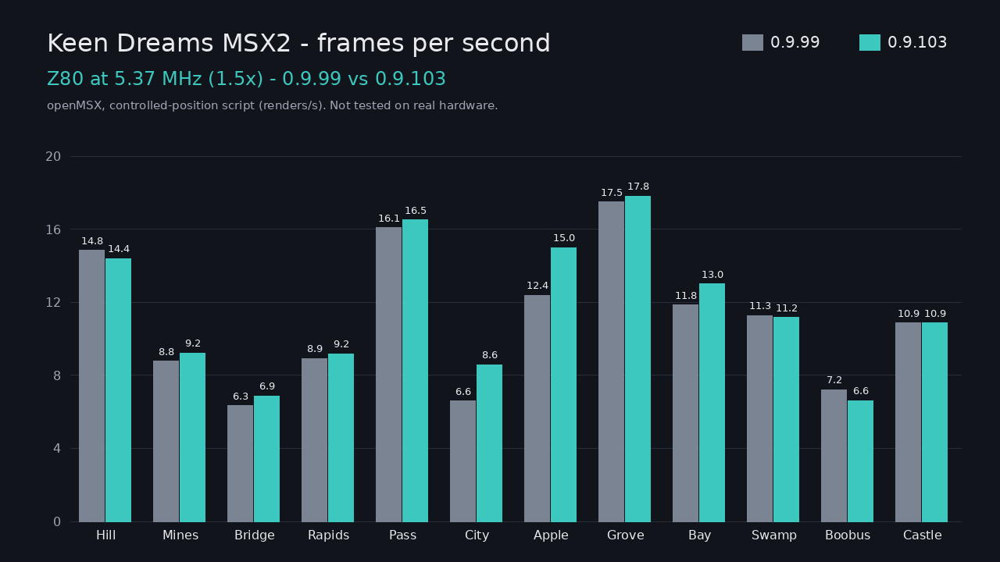
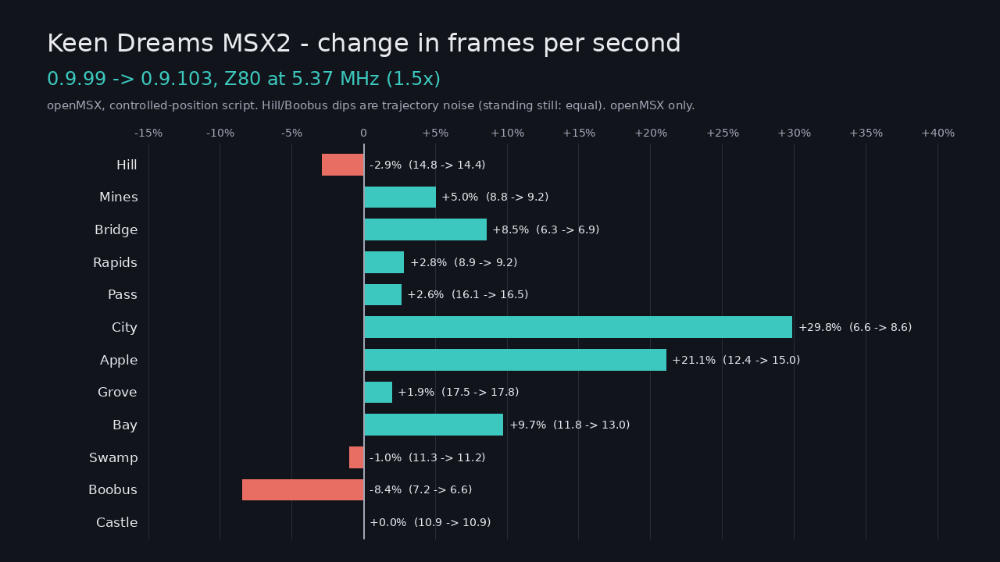
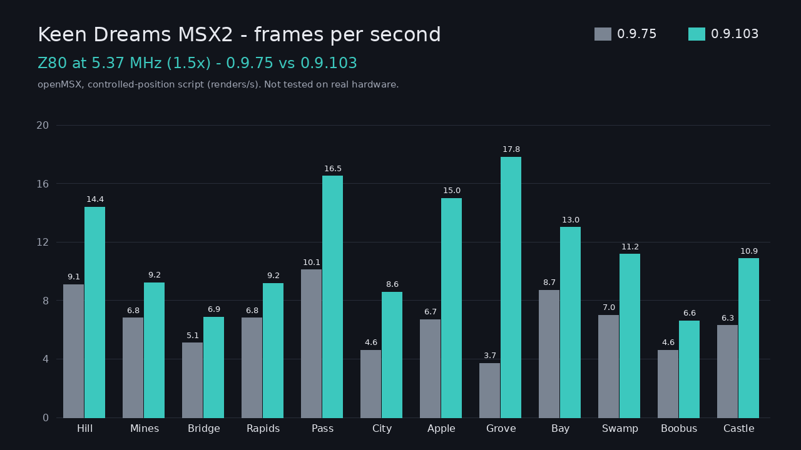
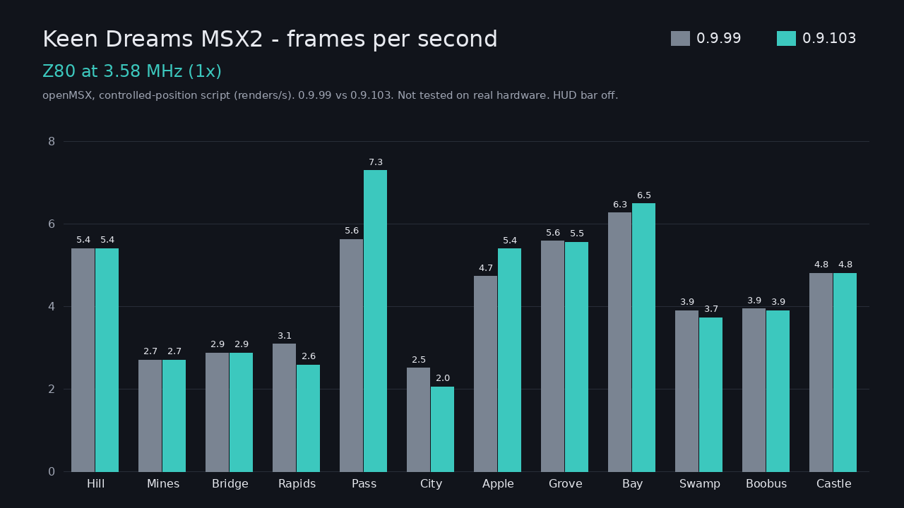
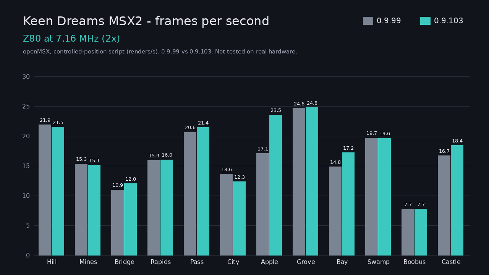
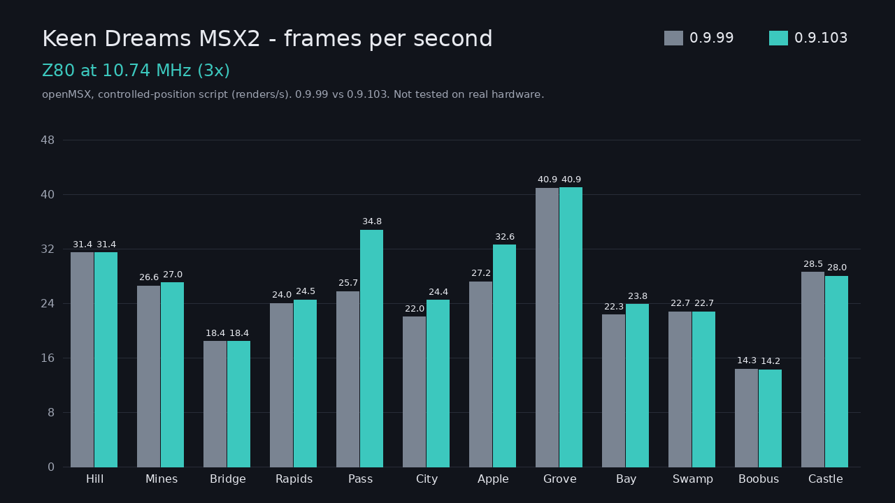
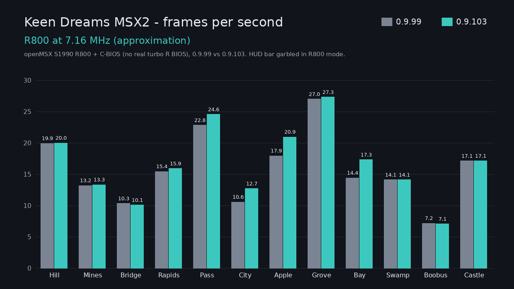

# Devlog — pronto para colar no itch.io

**Title:** Keen Dreams MSX2 0.9.103 — title screen fix, one-pass troopers, City and Apple 20–30% faster

**Post type:** Major Update or Launch

**Languages:** English (e Português, se o campo permitir mais de um)

**Tags:** msx, msx2, keen-dreams, port, retro, homebrew, optimization, performance

**Cover image:** `cover-16x9.png` (a mesma da 0.9.98, 1280×720; troque por uma captura nova de City/Apple se preferir)

**Attachments:** substituir os arquivos por `KEEN-0.9.103.ROM` e `KEEN-0.9.103-fontes.zip`; adicionar como imagens no corpo: `fps-0.9.99-vs-0.9.103-5.37MHz.png`, `fps-delta-0.9.99-vs-0.9.103.png`, `fps-0.9.75-vs-0.9.103-5.37MHz.png`, `fps-z80-1x-3.58MHz.png`, `fps-z80-2x-7.16MHz.png`, `fps-z80-3x-10.74MHz.png`, `fps-r800-7.16MHz.png` (todas na pasta `devlog/`).

**Comments:** Enabled · **Visibility:** Published

---

(Content abaixo — Markdown)

---

**0.9.103 is out.** Same campaign, same art. This one fixes the title screen, drops the MSX2 target in favour of MSX2+ only, and makes City and Apple a lot faster.

Thanks again to **byturn** for the detailed feedback on 0.9.98 — most of this release comes straight from it.

## What changed since 0.9.98

- **Title screen fixed (0.9.99).** Since 0.9.76 the title could stay black. The HUD-bar interrupts read a flag that was never initialised at start-up; with random RAM contents they rewrote the page/scroll registers every frame. The flag is now cleared before the hooks are installed. 0.9.62 and earlier were not affected.
- **MSX2+ is now required (0.9.99).** On a plain MSX2 (V9938) the software scroll hangs when scrolling left — the stack gets corrupted inside a routine that remaps its own bank window while running from it. There is no cheap fix, so the ROM now shows a message and stops on an MSX2.
- **Bayonet troopers, Aspar/Mouth and the broccoli enemies in one pass (0.9.100).** They are now `LMMM` + `TIMP` instead of AND + OR (same method as the Boobus boss): half the texture bytes and half the VDP commands for each of them. In these stages the CPU is the bottleneck, so the gain in fps is small — it mostly frees VPF/VDP time and ROM/VRAM bytes.
- **City and Apple (0.9.101–0.9.103).** Profiling showed that collecting what is on screen (`CityCollect`, `AppleCollect`, `AppleStatic`) and selecting actors (`CitySelect`) took a big slice of the frame, mostly in call overhead. They are now Z80 routines. The carts' contact test (`CartContact`) is also Z80. The ROM banks got smaller in the process.

Every rewrite was checked **inside the emulator against the original rule** (the C rule is recomputed on every call and compared, also with randomized inputs): zero mismatches in all of them.

## Numbers (openMSX, Z80 at 5.37 MHz)

| Stage | 0.9.99 | 0.9.103 | Change |
|---|---|---|---|
| 1 Hill | 14.8 | 14.4 | −2.9% * |
| 2 Mines | 8.8 | 9.2 | +5.0% |
| 3 Bridge | 6.3 | 6.9 | +8.5% |
| 4 Rapids | 8.9 | 9.2 | +2.8% |
| 5 Pass | 16.1 | 16.5 | +2.6% |
| 6 City | 6.6 | 8.6 | **+29.8%** |
| 7 Apple | 12.4 | 15.0 | **+21.1%** |
| 8 Grove | 17.5 | 17.8 | +1.9% |
| 9 Bay | 11.8 | 13.0 | +9.7% |
| 10 Swamp | 11.3 | 11.2 | −1.0% * |
| 11 Boobus | 7.2 | 6.6 | −8.4% * |
| 12 Castle | 10.9 | 10.9 | 0.0% |

\* **Within the noise of the method.** The script teleports Keen to fixed points and makes him walk and jump, and the trajectory is different for every ROM (±5–10% per stage). Standing still at the same spot, Hill and Boobus give the same result in both versions (148/148 and 124/122 renders), and neither stage got a relevant code change. Use these numbers to compare versions, not as absolute values; they are lower than real play because the scroll ring is rebuilt at each point.

For reference, the whole campaign from 0.9.75 (the version before the performance work started) to now:

## Other clocks and R800

The same script at each clock, 0.9.99 vs 0.9.103:

City and Apple improve at almost every clock (City +30% at 5.37 MHz, +11% at 10.74 MHz; Apple +21%, +38% at 7.16 MHz, +20% at 10.74 MHz). At **3.58 MHz** the game runs at 2–7 fps, the pace is quantized by the vblanks and the script is very sensitive to Keen's trajectory: a few bars there are negative (Rapids −16%, City −18%), and they are **not confirmed** when Keen is parked at fixed spots (City: 19→23 and 37→44 renders in 8.5 s; Rapids: between −9% and +3%, a technical tie). The HUD bar stays off below ~5 MHz.

**R800 (turbo R CPU)**, openMSX R800 core at 7.16 MHz. There is no turbo R BIOS in my test setup, so this is a C-BIOS MSX2+ machine with an S1990 added to switch the CPU — an approximation, not a real turbo R:

City +20%, Apple +17%, Bay +20%, Pass +8%; the others within ±3%.

## What did not work (also part of the work)

- **A Z80 version of just the on-screen test for the `Put` functions:** correct and smaller, but not faster — the cost was in the call overhead of the surrounding functions, not in the test. Rewriting the whole collect routines was what paid off.
- **`ActorsPrepare`** (the biggest self-time item in stages 6/7, ~9% of the frame): replacing its record comparisons with a Z80 routine made stage 6 7% *slower*, because the C code exits on the first difference. A real gain needs porting the whole slot loop (ceiling ≈ 3% of the frame, high risk), so I left it alone.
- Earlier: the boss's opaque rectangle with `HMMM` (slower), a two-level tile search and VDP/logic overlap (no gain).

## Honest caveats

- **Everything was measured in openMSX.** I have not tested on real hardware, and I would really appreciate reports from a real MSX2+ or turbo R — VDP I/O waits can differ from the emulator.
- **MSX2+ only** (see above). In **R800 mode the HUD bar comes out garbled** (its line timing was tuned for the Z80; the clock detection cannot tell the R800 apart by speed). The rest of the screen is fine. A proper fix needs the turbo R `GETCPU` BIOS call, which I cannot test here.
- **Keen's physics steps at 35 Hz** (two 70 Hz ticks per pass, since 0.9.65); the feel may differ slightly from the original.
- In isolated screenshots the HUD bar sometimes shows a one-frame glitch (the same picture as the bar being off during a death/transition). Not fully explained.
- TIMP coverage is still partial: the carts and the special bitmaps of City, Apple and Castle still use AND/OR on some frames.
- Drawing Keen himself as a bitmap (`LMMM` + `TIMP`) instead of hardware sprites is **still unmeasured**; I want to test it before deciding.

## Download

`KEEN-0.9.103.ROM` (ASCII16, 2 MiB, **MSX2+**) and `KEEN-0.9.103-fontes.zip` (full sources — building them gives the identical ROM, SHA-256 `10e4e706…087aee`).

To build: `MSXGL_ROOT=/path/to/MSXgl bash scripts/build.sh` (MSXgl 1.5.2 + the SDCC bundled with it).

If you find a bug or a stage that is slower than it should be, please tell me in the comments. Thanks for playing!

---

**Resumo em português:** a 0.9.103 corrige a tela de título que podia ficar preta (flag da barra de HUD não inicializada), passa a exigir MSX2+ (em MSX2 a rolagem por software trava e a ROM agora para com uma mensagem), desenha soldados com baioneta, Aspar/Mouth e Brocco em um único passe `LMMM`+`TIMP` e reescreve em Z80 a coleta de objetos de City e Apple, a seleção de atores de City e o contato com carrinhos. Em openMSX a 5,37 MHz: City +30%, Apple +21%, Bay +10%, Bridge +8%, demais entre −3% e +5% (as quedas de Hill/Swamp/Boobus são ruído de trajetória). Medido só no openMSX, sem teste em MSX real; barra de HUD ainda corrompida em modo R800; o Keen como bitmap segue sem medição.
