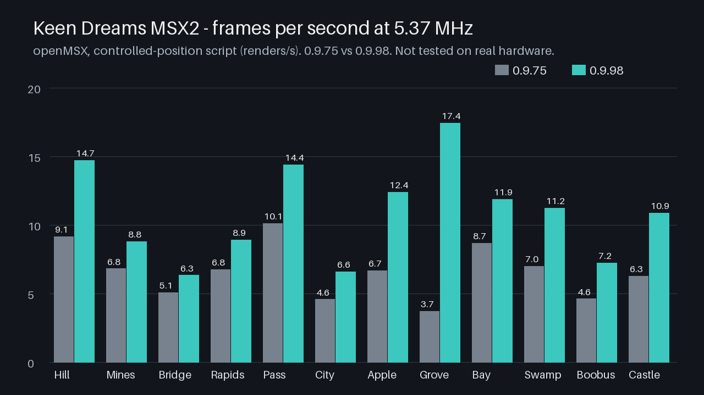
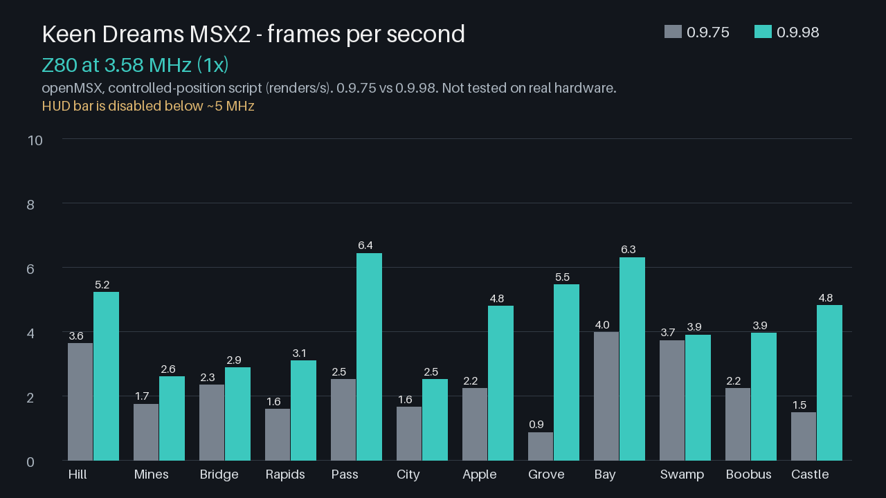
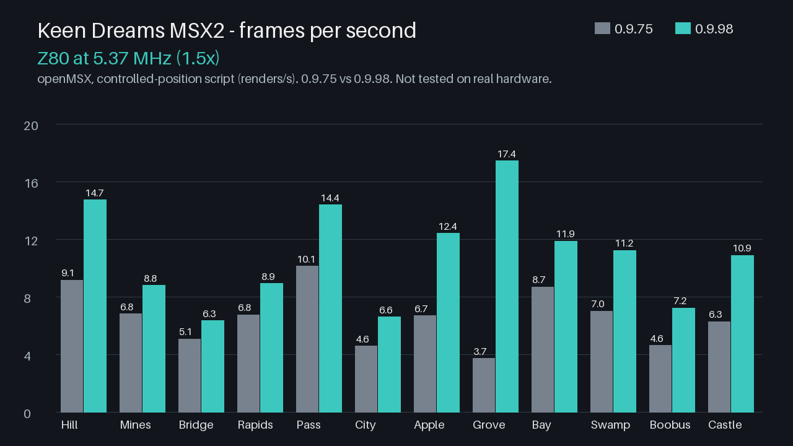
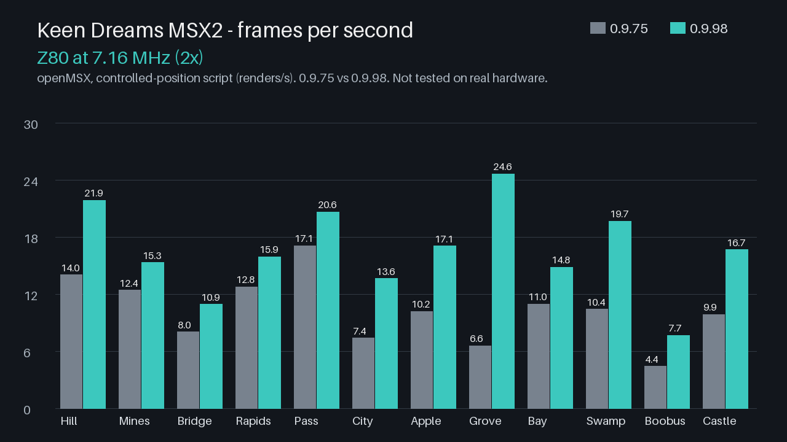
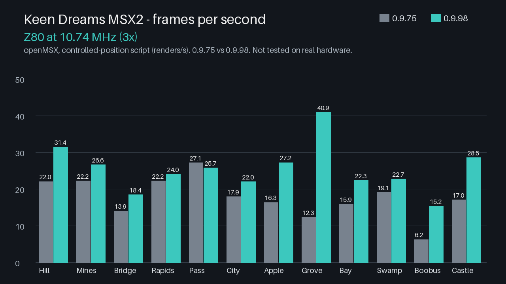
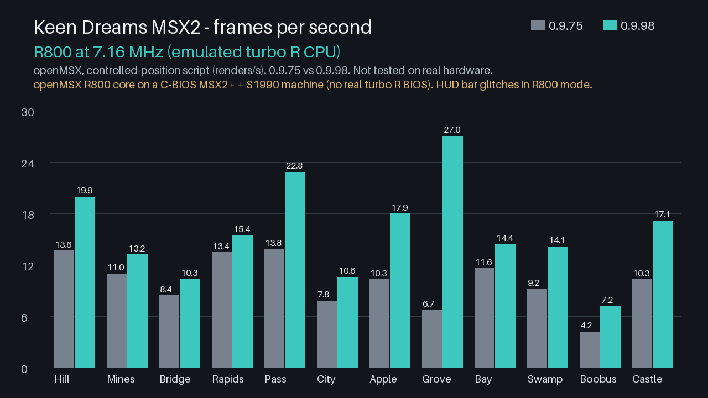

# Devlog — pronto para colar no itch.io

**Title:** Keen Dreams MSX2 0.9.98 — faster stages, one-pass sprites, fixed HUD bar

**Post type:** Major Update or Launch

**Languages:** English (e Português, se o campo permitir mais de um)

**Tags:** msx, msx2, keen-dreams, port, retro, homebrew, optimization, performance

**Cover image:** `cover-16x9.png` (recorte 16:9 da captura do chefe; 1280×720)

**Attachments:** manter `KEEN-0.9.98.ROM` e `KEEN-0.9.98-fontes.zip`; adicionar como imagens no corpo: `fps-chart.png`, `fps-z80-1x-3.58MHz.png`, `fps-z80-1.5x-5.37MHz.png`, `fps-z80-2x-7.16MHz.png`, `fps-z80-3x-10.74MHz.png`, `fps-r800-7.16MHz.png`.

**Comments:** Enabled · **Visibility:** Published

---

(Content abaixo — Markdown)

---

**0.9.98 is out.** Same campaign, same art — but the game runs a lot faster, and the HUD is now a fixed bar at the bottom of the screen.

A few days ago **byturn** left a comment pointing out that the sprites were drawn in two `LMMM` passes (AND with a mask, then OR with the colour), and that a single `LMMM` with `TIMP` would do the same in one pass. He was right, and this release is the follow-up. Thank you!

## What changed

- **One-pass sprites (`LMMM` + `TIMP`).** The hero, the Hill/Melon/Bridge atlases, many frames of the other stages and — new in this version — the **Boobus boss** are drawn in a single pass, and the freed mask area stays free. In a proof-of-concept scene dominated by actors, VDP busy time dropped from 405 ms to 179 ms (−56%). The boss alone went from ~4.4 to ~6.2 fps just from halving its pixels and its texture upload.
- **A lot of Z80.** Profiling showed that in most stages the CPU, not the VDP, was the bottleneck (the CPU waits for the VDP only 4–9% of the time in most of them). So the scroll ring, the actor and item lists, keys, bombs, carts and the bonus scans were rewritten in Z80. Every rewrite was checked against the original rule inside the emulator (zero mismatches) before it went in.
- **Page flip in the vblank interrupt.** Drawing no longer waits for the VDP; the flip only happens when the VDP is idle.
- **Fixed HUD bar at the bottom** (line interrupt) on MSX2+ from ~5 MHz up. Below that, the bar is disabled automatically and the HUD goes back to being drawn in the scroll ring.
- **Freeze fix.** From 0.9.76 to 0.9.87 the HUD bar could hang the game (stage 5 was where it showed up). Fixed.

## Numbers (openMSX, Z80 at 5.37 MHz)

| Stage | 0.9.75 | 0.9.98 |
|---|---|---|
| 1 Hill | 9.1 | 14.7 |
| 2 Mines | 6.8 | 8.8 |
| 3 Bridge | 5.1 | 6.3 |
| 4 Rapids | 6.8 | 8.9 |
| 5 Pass | 10.1 | 14.4 |
| 6 City | 4.6 | 6.6 |
| 7 Apple | 6.7 | 12.4 |
| 8 Grove | 3.7 | 17.4 |
| 9 Bay | 8.7 | 11.9 |
| 10 Swamp | 7.0 | 11.2 |
| 11 Boobus | 4.6 | 7.2 |
| 12 Castle | 6.3 | 10.9 |

These are renders per second from a script that teleports Keen to fixed points and makes him walk and jump, so they are lower than real play (the scroll ring is rebuilt at each point) — use them to compare versions, not as absolute values. Walking normally, Hill reaches ~40 fps at 5.37 MHz and ~44 fps at 7.16 MHz, and Grove ~36 fps at 5.37 MHz. At 3.58 MHz it runs, but slowly (Hill ~22 fps, the other stages between 3.5 and 17), and the HUD bar stays off.

## Other clocks

The same script at every clock (0.9.75 vs 0.9.98, renders per second):

The biggest relative gains are in the stages that were most CPU-bound (Grove, Pass, Apple, Boobus, Castle). At 10.74 MHz the stages that were already VDP-limited barely move (Pass is within noise: 27.1 vs 25.7).

**R800 (turbo R CPU).** I also ran it on openMSX's R800 core at 7.16 MHz. There is no turbo R BIOS in my test setup, so this is a C-BIOS MSX2+ machine with an S1990 added to switch the CPU — an approximation, not a real turbo R:

Two things to know: (1) on a real turbo R, a cartridge normally starts in Z80 mode unless something switches the CPU, and this ROM does not switch it; (2) **in R800 mode the HUD bar comes out garbled** in my tests — its line-exact timing was tuned for the Z80. The rest of the screen renders fine. I plan to make the clock detection turn the bar off on R800.

## Honest caveats

- **Everything was measured in openMSX.** I have not tested on real hardware, and I would really appreciate reports from a real MSX2+ or turbo R — VDP I/O waits can differ from the emulator.
- **Keen's physics now steps at 35 Hz** (two 70 Hz ticks per pass, since 0.9.65). Gravity and horizontal acceleration are applied the same way as in the original, but the feel may differ slightly.
- In isolated screenshots the HUD bar sometimes shows a one-frame glitch. I saw it in older versions too and have not found the cause.
- TIMP coverage is still partial (Rapids, Pass, Grove, Bay, Swamp and Castle still use AND/OR on many frames). The profile says those stages are CPU-bound, so the remaining gain would be small.
- Stage 10 (Swamp) numbers come from the controlled script only.
- R800 mode: HUD bar garbled (see above); measured only on the openMSX R800 core.

## Download

`KEEN-0.9.98.ROM` (ASCII16, 2 MiB) and `KEEN-0.9.98-fontes.zip` (full sources — building them gives the identical ROM, SHA-256 `370434e5…89221a9`).

To build: `MSXGL_ROOT=/path/to/MSXgl bash scripts/build.sh` (MSXgl 1.5.2 + the SDCC bundled with it).

If you find a bug or a stage that is slower than it should be, please tell me in the comments. Thanks for playing!

---

**Resumo em português:** a 0.9.98 troca o desenho dos sprites por um único passe `LMMM`+`TIMP` (inclusive o chefe da fase 11), reescreve em Z80 os laços quentes (rolagem, listas, chaves, bombas, carrinhos), move a troca de página para a interrupção de vblank e fixa a barra de HUD no rodapé. Em openMSX a 5,37 MHz as fases foram de 3,7–10 fps para 6,3–17 fps (Hill ~40 fps andando). Medido só no openMSX, sem teste em MSX real; a física do Keen passou a 35 Hz.
