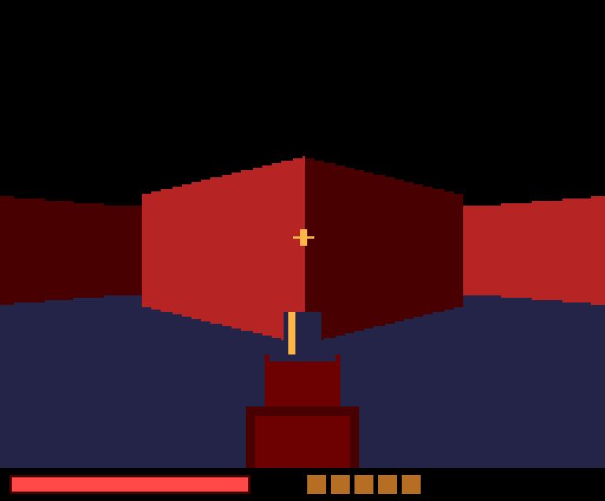
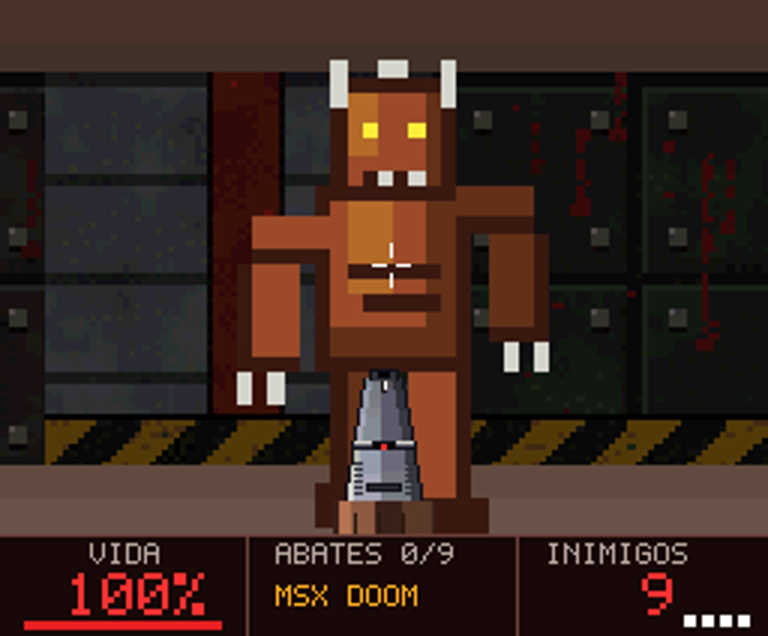
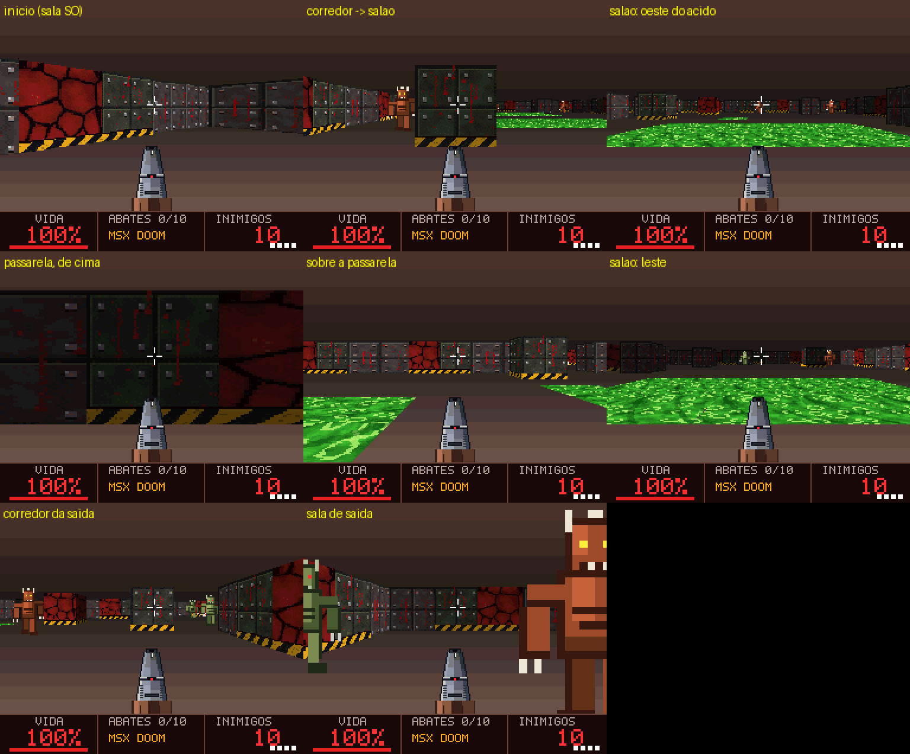

# MSX DOOM — ROM texturizada (turbo R + V9968 + Geo3D)

## E1M1 — MoonSound opcional

O driver detecta OPL4 e sample RAM em 0x7E/0x7F e 0xC4–0xC7. Carrega dez samples
DMX PCM8/11025 Hz do WAD privado em 105.680 bytes de RAM; cabe no MoonSound de
128 KiB. Não usa os instrumentos da YRW801. Conversão unsigned→signed, remoção
das margens DMX, rampas curtas contra clicks e término em loop silencioso.
São oito vozes simultâneas, alocação circular (a nona substitui a mais antiga),
volume por voz −15 dB e mix PCM −6 dB. Pistola, ataques, dor, mortes, coleta e
explosões têm samples distintos. A duração PCM independe dos quadros da engine;
não há streaming pela CPU durante a partida, só carga no boot e comandos de evento.
Reiniciar amortece todas as vozes. Não inclui música nem áudio posicional.

Sem OPL4/RAM, usa ruído PSG limitado ao volume 6/15 e três atualizações da engine.
O fallback NÃO reproduz os sons originais e sua duração ainda depende dos FPS.
Esperas BUSY/LD têm timeout; nenhum driver MSX-AUDIO/PCM turbo R foi adicionado.

Emulação opcional, sem baixar ROM Yamaha proprietária:
```sh
python3 tools/setup_e1m1_moonsound.py /caminho/openmsx/data
# Acrescente -ext e1m1_moonsound à linha de execução do fork Geo3D.
```
O XML reserva uma ROM vazia de 2 MiB só para satisfazer o modelo de MoonSound;
os efeitos estão integralmente na sample RAM. No pacote Linux, `./executar.sh`
usa MoonSound; `E1M1_AUDIO=psg ./executar.sh` testa a mesma ROM sem a expansão.
No hardware é necessário MoonSound/compatível com mapeamento padrão e ≥128 KiB RAM.
FPGA/hardware/BIOS Panasonic continuam UNTESTED.

Testes privados adicionais: `tools/test_e1m1_sound.py` (com E1M1_WAD e GEO3D_SIM)
e `E1M1_AUDIO=1 ... -script tools/test_e1m1_openmsx.tcl` no fork; sem extensão use
também `E1M1_EXPECT_MOON=0`. O segundo confere RAM, teclado, pitch, ganho, vozes,
reinício, gameplay e grava WAVs reais do emulador. As chamadas isoladas de samples
são feitas via debugger preservando o contexto da CPU; não são uma partida manual.

## E1M1 — revisão de HUD e combate

Esta revisão do E1M1 privado corrige os offsets do rosto e a largura individual dos números,
evitando copiar pixels de glifos vizinhos. A limpeza da munição não invade o campo de saúde;
os quatro marcadores de boot foram retirados da barra de status. A barra ocupa as 34 linhas
disponíveis: escala horizontal 256/320 e vertical 34/32, para compensar a diferença de aspecto
dos pixels. Rosto e números deixam de ficar achatados. Os patches usam nearest-neighbor.
A pistola ocupa a antiga região livre de flats, linhas 640–767; o HUD fica em 896–1023.

Os três tipos de inimigo usam todos os quadros **frontais** de caminhada, ataque, dor e morte.
Cada um percorre cinco quadros de queda (dois quadros da engine por pose) e mantém o cadáver.
O temporizador de ataque/dor agora termina corretamente. O atlas 256×128 empacota 58 patches;
as billboards preservam proporções e offsets do WAD em vez de encaixar todas as poses numa célula fixa.
As oito direções e mortes extremas alternativas ainda não estão implementadas.

Barris têm 20 HP: recebem tiros, animam BEXPA0–BEXPE0 e explodem no terceiro quadro da sequência.
Dano radial: `128 − max(abs(dx), abs(dy))`, até 128 unidades, condicionado à LOS rasterizada.
A armadura absorve 1/3 do dano ao jogador; inimigos e outros barris também são atingidos.
Barris em explosão não recebem novos tiros e são removidos ao terminar. A sequência continua
se o jogador morrer; reiniciar restaura os barris. O tempo das animações segue os quadros da engine,
não os tics de 35 Hz do Doom original.

Regressões privadas (SDCC 4.2.0, `z80==1.2.0`, numpy/Pillow e modelo de referência Geo3D):
```sh
E1M1_WAD=/caminho/doom1.wad python3 -I tools/test_e1m1.py
E1M1_WAD=/caminho/doom1.wad python3 -I tools/test_e1m1_gameplay.py
python3 -I tools/test_e1m1_debug.py
E1M1_WAD=/caminho/doom1.wad python3 -I tools/test_e1m1_ceiling.py
```
`test_e1m1_openmsx.tcl` aceita `E1M1_GAMEPLAY=1` para conferir HUD, queda, tiro no barril,
dano e reação em cadeia diretamente no fork. São cenários preparados pelo debugger, não uma
partida completa. A contagem usa o latch do VDP para não tratar dados `0x82` como escrita do R#2,
e executa as verificações na troca de página, sem avançar acidentalmente o estado seguinte.
As medições históricas abaixo devem ser tratadas separadamente das novas medições corrigidas.
Na comparação atual, ambas as ROMs deram 10,90 FPS no início e 9,59 com TAB, sem regressão
mensurável nesses dois casos. Capturas `.vram` são o framebuffer lido diretamente do fork
na troca de página; em execução acelerada, o screenshot SDL pode refletir um frame anterior.

Não foram corrigidos nesta revisão PVS, near clipping, ordenação painter, portas abertas,
elevadores ou os glitches do cenário. FPGA, BIOS Panasonic e hardware físico permanecem UNTESTED.
WAD, ROM e dados derivados continuam privados e fora do Git.

**Fase "HANGAR"**: 26×26 células, original (inspirada no *espírito* do E1M1, sem copiar a geometria de nenhum mapa da id Software): sala inicial, corredor, grande salão com poço de ácido e passarela, salas laterais e sala de saída. Veja `out/tour.png`.

ROM **ASCII16** de 1 MiB em C/SDCC: SCREEN 8 com paleta **EPAL de 256 cores**, paredes **texturizadas pelo Geo3D**
(LRMM por linha), inimigos como billboards texturizados com transparência, arma/mira/HUD por blits de fonte.
O protótipo web com a mesma arte está em [`../msxdoom`](../msxdoom).

 



```sh
./build.sh                         # SDCC >= 4.2, Python 3, numpy, pillow  ->  out/msxdoom.rom
python3 tools/test_boot.py         # boot no Z80 emulado: VRAM, paleta, quadro e aviso de Geo3D ausente
# o simulador usa o modelo do desenvolvedor: git clone https://github.com/alexmoncks/V9968_Cartridge e
#   export GEO3D_SIM=<clone>/geo3d/sim   (padrão: /home/user/alexmoncks/v9968_cartridge/geo3d/sim)
python3 tools/test_game.py         # 7 testes de lógica (andar, girar, colisão, tiro, fim de jogo, reinício)
python3 tools/z80_harness.py 4     # renderiza quadros em out/harness_N.png
python3 tools/tour.py              # passeio pela fase -> out/tour.png
node tools/export_art.js           # reexporta a arte de ../msxdoom/sprites.js
node tools/export_art.js           # (opcional) reexporta a arte de ../msxdoom/sprites.js para assets/*.png
```
Rodar (**o tipo de ROM precisa ser ASCII16 explicitamente**):

```text
# turbo R / R800 (BIOS própria):
openmsx -machine Panasonic_FS-A1ST_V9968 -ext geo3d -cart out/msxdoom.rom -romtype ASCII16
# MSX2+ / Z80, sem turbo R e sem BIOS dumpada (C-BIOS):
openmsx -machine C-BIOS_V9968_JP -ext geo3d -cart out/msxdoom.rom -romtype ASCII16
```
`machines/C-BIOS_Z80_V9968_Geo3D.xml` (neste repositório) é a mesma máquina com o Geo3D já embutido: copie para `share/machines/` e rode `openmsx -machine C-BIOS_Z80_V9968_Geo3D -cart out/msxdoom.rom -romtype ASCII16` **sem** `-ext geo3d`. **UNTESTED** (montei o XML a partir dos dois arquivos de origem, validei só que é XML bem formado).

`C-BIOS_V9968_JP` não vem no openMSX oficial: é o `config/machines/C-BIOS_V9968_JP.xml` do repositório
[renatus-xxxx/openmsx-v9968-windows-setup](https://github.com/renatus-xxxx/openmsx-v9968-windows-setup) (o `setup-cbios-v9968.bat` monta o ambiente),
usado com o openMSX com Geo3D de [alexmoncks/openMSX](https://github.com/alexmoncks/openMSX) (ramo `geo3d`), conforme o `README.geo3d.md` dele.
Nesse perfil `MSXVER=2`, então a ROM **não** chama `CHGCPU` e roda em Z80. **Z80 não é mais rápido que o R800**: use-o só se o turbo R der problema. Controles: cursor ←/→ giram, ↑/↓ andam, ESPAÇO atira/reinicia.

## Status de validação

| Nível | Resultado |
|---|---|
| BUILD OK | Sim. SDCC 4.2.0. Código: 10 KB do banco 1; 36 bancos de dados (texturas + conjuntos visíveis de 154 células); ROM 1 MiB. |
| BOOT OK | **UNTESTED** (openMSX, blueMSX+, FPGA, hardware) |
| SIMULATED | Sim: a ROM roda num Z80 emulado (pip `z80`) com modelo próprio e simplificado de ASCII16 e do V9968 (SCREEN 8, EPAL, HMMV, LMMM/TIMP). O **Geo3D é simulado pelo modelo de referência bit-exato do desenvolvedor** (`geo3d/sim/gen_scenes.py::render_faces`, em `alexmoncks/V9968_Cartridge`) com um executor de LRMM conforme `vdp_command.v`. `test_boot.py`, `test_game.py` e `test_mulq14.py` passam. **Não é um emulador de MSX.** |
| EMULATOR TESTED | **Relatado pelo usuário, não verificado por mim:** v5 no openMSX (fork Geo3D) com a máquina `C-BIOS_R800_V9968_Geo3D` (definição própria do usuário; não tenho o XML), com `-ext geo3d` e `-romtype ASCII16`: "melhorou muito" em velocidade. Sem medição de fps, sem vídeo e sem confirmação dos marcadores do HUD. |
| FPGA TESTED / HARDWARE TESTED | **UNTESTED** |

```text
MSXgl: não usado                    SDCC: 4.2.0 #13081
V9968 spec/revision: hra1129/V9968_Cartridge 55966fb (RTL: vdp_cpu_interface.v, vdp_command.v)
Geo3D reference model / demos: alexmoncks/V9968_Cartridge eeb13f4 (geo3d/sim, geo3d/z80/geo3d_tex_demo.asm, geo3d/game)
Geo3D spec/revision: geo3d_engine.v (alexmoncks, v1.0.0)  | referências: kanon-ai/V9968_Geo3D_SampleDemo 3fe8a01, NEON_REVENANT 030555e
openMSX build / commit / Machine XML: não testado
V9968 configuration: I/O base 0x98 (Geo3D em 0x9D/0x9F)    Mapper: ASCII16   ROM size: 262144
Target machine: MSX turbo R + V9968 + Geo3D    CPU mode: R800 ROM (CHGCPU 0x81) se MSXVER>=3
Test status: BUILD OK + SIMULATED; EMULATOR: relato do usuario (v5, C-BIOS_R800_V9968_Geo3D); FPGA/HARDWARE UNTESTED
```

## Como funciona
- **Mapper:** banco 0 = cabeçalho `AB` + boot; o boot seleciona o banco 1 na janela 0x8000 (`0x7000`) e faz `ENASLT` da página 2 para o slot do cartucho; o **código roda do banco 1**. Os dados ficam nos bancos 2+, lidos pela janela 0x4000 (registrador em `0x6000`).
- **Vídeo:** `R#0=14` (SCREEN 8), `R#20=0x11` (EPAL + HS) após `OUT (0x9C),0`, `R#21=0`, `R#16`+porta `0x9A` com 256×(R,G,B de 5 bits) (RTL: `vdp_cpu_interface.v`). `R#51..58 = 0,0,0,0,255,0,255,3` (janela de origem do LRMM), como o NEON_REVENANT.
- **VRAM (256 KiB = 1024 linhas de 256 B):** páginas de desenho em 0..511 (`YPAGE = página<<8`); texturas em 512..1023 (carregadas no boot a partir dos bancos 2..9):

| Linhas | Conteúdo |
|---|---|
| 512–575 | atlas de paredes 256×64 (4 tiles 64×64), cópia escura (nível 0) |
| 576–639 | sprites 256×64 (2 tipos × 6 poses, 24×32), sem sombra |
| 640–703 | atlas de paredes, cópia média (nível 2) |
| 768–831 | atlas de paredes, cópia clara (nível 4) |
| 832–895 | pistola (parada e disparando) e clarão |
| 896–934 | fontes 5×7 (cinza, laranja, vermelho) e dígitos grandes |

- **Por que só 3 cópias de sombra:** o Geo3D escolhe a linha-fonte por `TEXY + nível*TSTRIDE`. A luz é **fixa no mundo** (recalculada por quadro no espaço da câmera), então paredes alinhadas aos eixos só recebem os níveis 0, 2 e 4; os intervalos entre as cópias guardam sprites. Com `TSTRIDE=0` os sprites usam uma cópia só.
- **Paleta (256):** 63 cores-base escolhidas por median-cut sobre as texturas, em 3 brilhos (índices 1–63 claro, 65–127 médio, 129–191 escuro; 0 = preto/transparente) + 14 rampas de teto/chão + cores do HUD.
- **Geometria (PVS por bloco 2×2):** `tools/pvs.py` calcula, para cada bloco de 2×2 células abertas, quais paredes e quais células de ácido podem ser vistas dali (visibilidade 2D, até 36 pontos de vista × 3 amostras por parede). Cada parede vira 8/4/2/1 tiras conforme a distância; paredes alinhadas e distantes são **fundidas** (2 ou 4 células num quadro, textura esticada) para caber nos vértices. 79–106 faces e ≤215 vértices por bloco (limite do Geo3D: 255; reservei 10 sprites). O ácido é piso texturizado (faces horizontais). **Ao entrar num bloco** a ROM envia esse conjunto ao Geo3D uma única vez (~3 KB); por quadro vão só a matriz, a luz, as faces dos sprites e o RUN. Se mesmo assim estourar o limite, o gerador sacrifica primeiro células de ácido distantes (433 no total, nenhuma parede). Jogador com raio de colisão 14 e `ZNEAR=2`.
- **Inimigos:** cada inimigo visível vira um quad (billboard) em coordenadas de mundo, anexado às faces da célula **no mesmo RUN**; o Geo3D ordena (painter) paredes e sprites juntos. A normal do quad gera o nível de sombra 1, cuja cópia de textura (linhas 576–639) é o atlas de sprites; `LOP=8` (TIMP) dá a transparência. Só são enviados se estiverem no campo de visão e com linha de visão livre (recalculada a cada 4 quadros).
- **Arma e HUD:** LMMM com TIMP a partir da VRAM; o painel (y ≥ 178) é desenhado nas duas páginas, e os valores só são redesenhados quando mudam.

## Conferido contra o código do desenvolvedor do Geo3D
Li o `geo3d_tex_demo.asm`, o jogo `geo3d/game/*.asm`, `geo3d_rom.asm` e o modelo de referência. Bate: sequência de registradores (config em `0x18`, bloco `0x40`, streams `0x50/0x52/0x53`, `0x58` e `0x60`), RUN por `0x48`, espera por `bit0` do status, detecção de Geo3D ausente (`IN A,(0x9D)` = `0xFF`), tempo-limite nas esperas, desbloqueio `Port#4`, `R#21=0`, `R#20` com HS, janela de origem `R#51–58`, `ROM_AS16` em `0x4010`. O TIMP no LRMM está no RTL (`func_lop`). As faces/skip/níveis de sombra foram conferidos com o `render_faces` dele. Diferenças conscientes: eu uso SCREEN 8/EPAL (ele, nas demos, SCREEN 5), `F=170`, `ZNEAR=2`.

## Suposições NÃO verificadas em emulador/hardware (revisar primeiro se algo falhar)
1. **TIMP no LRMM:** `LOP=8` nos sprites faz o texel 0 ser transparente. Está no RTL (`func_lop`), mas não vi o comportamento num emulador. Se estiver errado, os inimigos aparecem com fundo preto. As paredes usam `LOP=0`, como a demo do desenvolvedor.
2. Matriz enviada linha a linha e `p' = M·v + T`; câmera +Z frente/+X direita/+Y cima; `F=170, CX=128, CY=89, ZNEAR=2, W=256, H=178`.
3. Coordenadas U/V são relativas a `TEXX/TEXY` (e o nível soma `nível*TSTRIDE` às linhas), como descreve o cabeçalho de `geo3d_engine.v`.
4. `IN A,(0xFF)` / `XOR 1` / `OUT (0xFE),A` no boot foi **copiado de todas as demos kanon-ai**; a finalidade não está documentada (provavelmente configuração do cartucho/máquina V9968).
5. Teclado: linha 8 da matriz (setas e espaço), como no NEON_REVENANT; PSG: `R7=0xB7`. `R#2 = 0x1F | página<<5` para trocar de página; polling de VBLANK em S#0 bit 7.
6. A rampa de brilho e o atlas foram validados só pelo meu simulador (rasterização afim por linha, como descrito no RTL).

## Achados e limitações
- **Bug do SDCC 4.2.0:** `(s32)a*b` com multiplicador negativo deu resultado errado; o jogo usa `mulq14()` (soma e deslocamento), validado contra Python em 600 pares.
- **Desempenho (medido só em simulação; UNTESTED no openMSX):** `tools/profile.py` conta T-states de CPU por quadro. v1: ~1,21 M; v4: ~0,56 M; **atual: ~0,15 M (~24 fps de teto de CPU em Z80 de 3,58 MHz)**. O envio ao Geo3D caiu de ~11 KB para ~1,3 KB por quadro e de 16 RUNs para 1 por quadro. Ganhos desde a v1: `mulq14` em assembly (`src/math.s`), conjuntos visíveis por célula enviados só ao mudar de célula, `los()` sem divisão e em cache, HMMV nos preenchimentos, inimigos fora de vista filtrados e inimigos distantes parados. **Não medi** o tempo de VDP/Geo3D (LRMM, HMMV) no emulador, que pode dominar. Para referência, as demos de Geo3D texturizado do desenvolvedor rodam a 5–13 fps no openMSX dele. Ao mudar de célula há um pico (~2,5 KB a mais num quadro).
- Sem Z-buffer por pixel: o Geo3D ordena por face (soma dos Z dos 4 vértices), então um sprite muito perto de uma parede oblíqua pode ordenar errado em casos extremos. Sem sombreado por distância. A ROM tem 1 MiB porque guarda um conjunto visível por bloco 2×2 (~380 KB); cabe em ASCII16.
- Sem mouse, sem portas que abrem, sem tela de título, sem texto de vitória/derrota (só uma faixa colorida).
- **Diagnóstico na tela:** se o Geo3D não responder (porta `0x9D` lê `0xFF`), a ROM mostra "GEO3D NAO ENCONTRADO" em vez de travar; esperas pelo Geo3D têm limite de tempo. Quatro quadradinhos brancos no canto inferior direito do HUD marcam o progresso (1 boot/VRAM/paleta, 2 Geo3D detectado, 3 primeiro quadro desenhado, 4 primeiro quadro exibido); do 3º em diante ficam avermelhados se um RUN do Geo3D estourou o tempo. HUD aparecendo com a área 3D preta = o jogo parou esperando o Geo3D (use `-ext geo3d`).
- **Se a imagem sair preta ou sem texturas**, verifique nesta ordem: ROM tipo ASCII16; extensão `geo3d` no openMSX; EPAL/`R#20`; janela do LRMM (`R#51–58`).

## E1M1 a partir do SEU doom1.wad (build privado)

O mapa E1M1 original é convertido a partir de um `doom1.wad` que **você** fornece. O WAD, os dados convertidos e a ROM gerada
**não ficam no repositório** (`private/` está no `.gitignore`); só o código do conversor/motor é versionado. Uso pessoal.

```sh
tools/build_e1m1.sh /caminho/doom1.wad [skill 1-5]     # padrão: skill 3 (Hurt Me Plenty) -> private/e1m1.rom (2 MiB, ASCII16)
E1M1_WAD=/caminho/doom1.wad python3 -I tools/test_e1m1.py   # testes de lógica no Z80 emulado
python3 -I tools/e1m1_tour.py [x y angulo ...]              # folha de contato -> private/tour.png
```

O que vem do WAD: geometria (linedefs/sidedefs/sectors), alinhamento de texturas com as regras de peg do Doom, texturas de parede,
sprites (zombieman, shotgun guy, imp, itens, decoração), HUD (STBAR, números, rosto), pistola, posição de todas as coisas do skill escolhido.
Conversão: paredes → faces do Geo3D com o PVS por bloco de 128 unidades e por direção do olhar (4 conjuntos de 90°, cone de ±92°; ROM de 4 MiB), com peças distantes
(>220 unidades) em uma face só com a textura esticada; `tools/e1m1_holes.py` mede a área de parede perdida contra o modelo sem limites (~3% em média, p90 ~9–10% em 80 amostras na simulação). Antes: (visibilidade 2D em C; ~98% da área projetada cabe nos limites de 255
vértices/faces; o que sobra é descartado do mais distante/menor para o maior); texturas a 0,25–0,5 texel/unidade; paleta de 256 cores; raster de
8 unidades para colisão, setor e altura de piso.

Estado desta fase: **BUILD OK + SIMULATED + OPENMSX TESTED** (perfil sintético C-BIOS/R800/V9968/Geo3D, com ativação de R800 pelo debugger).
**BIOS Panasonic, FPGA e hardware físico: UNTESTED.** O resultado do harness continua sendo apenas SIMULATED.
Fase 1 NÃO tem: portas funcionando (ficam abertas), elevadores, pisos/tetos texturizados (faixas de cor do setor), iluminação por setor,
projéteis do imp (ataque instantâneo), espingarda como arma (o item só dá munição), explosão de barris, itens/monstros em áreas só
alcançáveis por segredos (os 4 itens do fechamento secreto sudeste são ignorados). Colisão é por raster de 8 unidades.
Teclas: setas = mover/girar, ESPAÇO = atirar, ENTER = usar (sair da fase perto do interruptor), **TAB = mostrar/ocultar X, Y e ângulo Doom**.

### TAB e validação direta da retomada

O painel inicia desligado. TAB alterna uma vez por pressionamento, inclusive no fim de jogo; segurá-lo não alterna repetidamente.
O empacotador de bancos desempata blobs de mesmo tamanho pelo conteúdo, tornando o build independente de `PYTHONHASHSEED`.
O formato é `X1056 Y-3616 A90`, em unidades do WAD e graus Doom: leste=0, norte=90, oeste=180, sul=270.
Ao desligar, a renderização normal apaga o painel nas duas páginas. O painel fica em y=14 e não substitui as mensagens em y=4.

```sh
# Dependências do harness: z80==1.2.0, numpy, Pillow; GEO3D_SIM aponta para geo3d/sim do modelo de referência.
python3 tools/test_e1m1_debug.py    # TAB, duas páginas, todos os 256 yaw e extremos de s16
E1M1_WAD=/caminho/doom1.wad python3 tools/test_e1m1.py

# Só no perfil sintético C-BIOS + S1990 (Geo3D já incluído na máquina):
# Instale machines/C-BIOS_R800_V9968_Geo3D.xml em share/machines do fork, com as ROMs C-BIOS MSX2+.
openmsx -machine C-BIOS_R800_V9968_Geo3D -cart private/e1m1.rom -romtype ASCII16 \
  -script tools/enable_cbios_r800.tcl
openmsx -machine C-BIOS_R800_V9968_Geo3D -cart private/e1m1.rom -romtype ASCII16 \
  -script tools/test_e1m1_openmsx.tcl
```

O script de ativação resolve uma limitação do perfil de teste: sua C-BIOS MSX2+ informa `MSXVER=2` e não possui CHGCPU de turbo R.
Ele seleciona R800 ROM no S1990 ao entrar no cartucho, sem modificar a ROM/BIOS. **Não é para um turbo R físico**, cuja BIOS é usada pelo boot da ROM.
O teste automatizado exige esse perfil, confere S1990 R6=64, TAB por matriz de teclado, pixels do texto, limpeza, movimento e rotação;
grava evidências em `private/openmsx/`, incluindo FPS por 60 trocas de página e tempo emulado. Não mede o refresh do monitor nem velocidade do PC.

Medição direta no fork Geo3D `de29fb8`, R800 ROM, simulação do jogo ativa:

| Cena | FPS |
|---|---:|
| Início olhando norte, TAB desligado | 9,22 |
| Mesma posição e direção, TAB ligado | 7,99 |
| Início olhando leste / sul / oeste | 12,62 / 13,32 / 9,22 |
| Corredor da porta (já aberta) | 7,19 |
| Posição preparada de combate | 10,90 |

Essas cenas são selecionadas pelo debugger, não um percurso completo. O fork não cobra tempo pela geometria do Geo3D e o timing do VDP é aproximado;
os números **não preveem FPS em FPGA/hardware**. O TAB tem custo mensurável; deixe-o desligado ao avaliar desempenho normal.

### Revisão visual do teto

A máscara preta pós-renderização (`ceil_probe`/`ceil_fill`) foi removida: suas faixas de 16 pixels encobriam paredes e sprites.
O fundo usa a cor média do teto do setor atual (céu nos setores F_SKY1). Até quatro planos de teto por lote são adicionados ao Geo3D,
na altura e cor dos respectivos setores, ordenados junto das paredes e sprites. **Só usam vértices/faces livres**, sem substituir paredes ou pisos existentes.
O teste `E1M1_WAD=/caminho/doom1.wad python3 -I tools/test_e1m1_ceiling.py` confere os 1232 lotes, suas listas originais e limites de hardware.

Isso é uma aproximação de teto liso, **não teto texturizado nem clipping/oclusão por pixel completos**. A cobertura dos planos é limitada;
faces que cruzam o near continuam sujeitas ao descarte do Geo3D. O fundo de cor do setor cobre essas lacunas sem blocos pretos.
Em lacunas ainda pode aparecer geometria distante que deveria estar oculta; a oclusão integral continua pendente.
Portas abertas, pisos simplificados e limitações de geometria/PVS permanecem.

Comparação controlada no mesmo fork/perfil R800, TAB desligado, 60 frames por cena:

| Posição X, Y, ângulo Doom | Antes | Revisão |
|---|---:|---:|
| 1056, -3616, 90 | 9,22 FPS | 10,89 FPS |
| 508, -3230, 2 | 8,88 FPS | 11,98 FPS |
| 1615, -2511, 2 | 7,92 FPS | 10,27 FPS |
| 1765, -2540, 320 | 9,22 FPS | 11,98 FPS |

O script de teste aceita `E1M1_MAP`, `E1M1_HEADER` e `E1M1_SCENES` para comparar ROMs distintas com os respectivos símbolos/cabeçalho.

Pisos e ttetos (v3): uma LRMM por linha de tela (plano em perspectiva) com o flat do setor do jogador (tile 16x16 por 64 unidades, replicado pelo VDP em regioes
256x64 da VRAM, linhas 640..767; janela de origem LRMM X 0..511 para o wrap). So ate ~120 unidades de profundidade (as linhas mais proximas); alem disso volta a
faixa de cor do flat. Custo: o atlas de paredes caiu para 128 linhas (algumas texturas voltaram a 0,25 texel/unidade). Corrigido tambem o endereco do upload das
fontes (antes ficavam fora da VRAM util).

v4: piso/teto texturizados ate ~240 unidades (linhas de profundidade >120 usam 2 LRMM de 128 pixels). Limitacao conhecida: so existe UM plano de piso e UM de teto por quadro
(o flat e a altura do setor do jogador); setores vizinhos com teto/piso em outra altura ou outro flat aparecem com o plano do jogador na altura errada.

v5: pisos/tetos POR SETOR. Um raio pelo centro da tela (passos de 32 unidades) lista os setores a frente; cada um desenha seu flat e sua altura (z=160*H/r) em ordem
do mais longe ao mais perto. Aproximacao: o setor do centro vale para a linha inteira (cantos laterais podem mostrar o flat/altura do setor do centro).

v6: leque de 8 raios (um por faixa de 32 colunas, passos de 32 unidades de profundidade) em vez de um raio central: cada faixa tem a propria sequencia de setores, e cada linha
de tela pertence ao segmento mais proximo da faixa; faixas vizinhas do mesmo setor viram uma LRMM so. Inicio do mapeamento arredondado ((X+2)>>2). Limite que permanece: o inicio de
cada linha so tem precisao de 1 texel (4 unidades) porque SX/SY da LRMM nao tem fracao, entao a textura pode tremer de leve ao andar. Banco de codigo: ~15,3 KB de 16 KB.

v7 (desempenho): pisos/tetos TEXTURIZADOS agora sao opcionais, tecla TAB (padrao: desligado = cores lisas por setor, com 2 tons). Medido no Z80 emulado (so CPU, sem esperas de VDP/Geo3D):
sem pisos ~0,5 M T-states/quadro; cores por setor ~0,74 M; texturizado ~1,4 M (antes 5,8 M). Z80 a 3,58 MHz fica lento de qualquer jeito; prefira a maquina R800. O modo texturizado usa blocos de 2/4 linhas por LRMM
(NY>1: a linha seguinte avanca (-VY,+VX) no espaco da textura) e a camera de mapeamento encaixada na grade de texels, para o piso nao tremer linha a linha.

v8: teto = preto liso (o plano unico de teto vazava texturas de setores vizinhos); piso = cores do setor 96 unidades a frente (nao pula ao trocar de setor). TAB liga piso texturizado
por setor (so piso). Padrao: ~0,50 M T-states/quadro de CPU (so o custo base); piso texturizado ~1,0 M. Suspeita de gargalo no openMSX: area preenchida por quadro (HMMV da tela toda + texels do Geo3D).

v9: pisos e tetos como GEOMETRIA no PVS (retangulos de 32..320 unidades por setor, faces lisas do Geo3D): o teto de um setor baixo oculta o que esta alem/acima (antes a parede alta do salao vazava
por cima do teto rebaixado) e pisos de outros setores (lago, degraus) ficam na altura certa. Tetos so para setores com vizinho mais alto; tiles que tocam o bloco do jogador sao omitidos (a faixa de cor cobre).
Competem com as paredes pelo limite de 255 vertices/faces (peso: tetos 3x, pisos 0,25x). Paleta: indices < 128 reservados a cores lisas. ROM ainda de 4 MiB (empacotamento first-fit decrescente dos blobs).

v11: TETO PRETO SOLIDO em tempo de execucao: depois do Geo3D, tudo acima da linha do teto e pintado de preto. A linha vem de um leque de 8 raios (12 passos de 32 de profundidade, recalculado a cada 2 quadros): por faixa
de colunas, max sobre os trechos de setor de 89-160*H/d_fim (H = teto - altura do olho); entre faixas interpola (diferenca >24 linhas: usa a menor). Removidos: piso texturizado por LRMM (TAB), tampas pretas e tetos como geometria.
Pisos continuam como faixas do setor a frente + retangulos lisos no PVS. Banco de codigo: ~12,7 KB.
