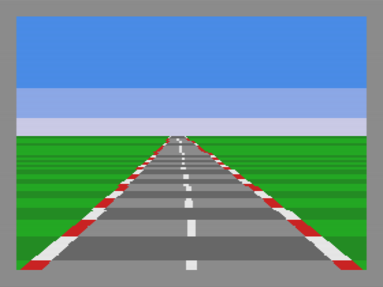
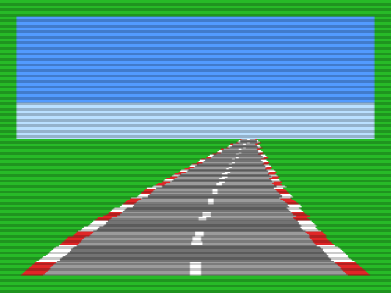
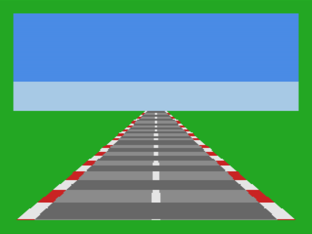
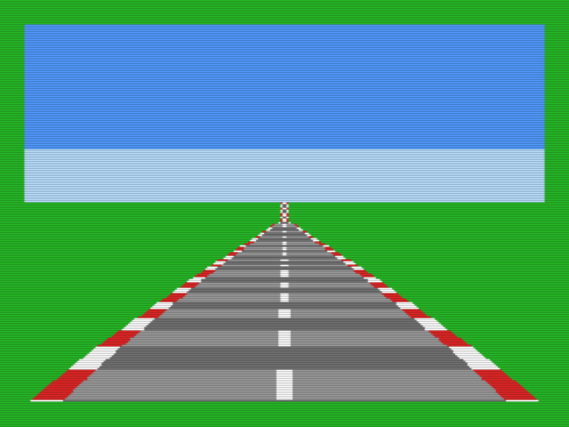
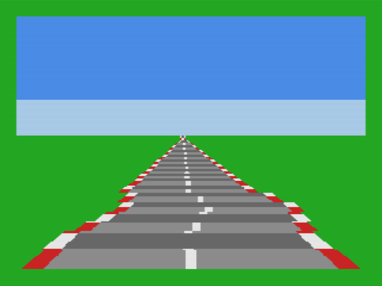
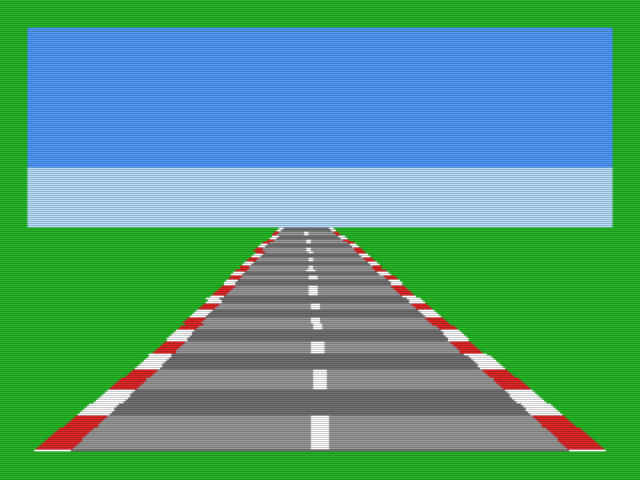
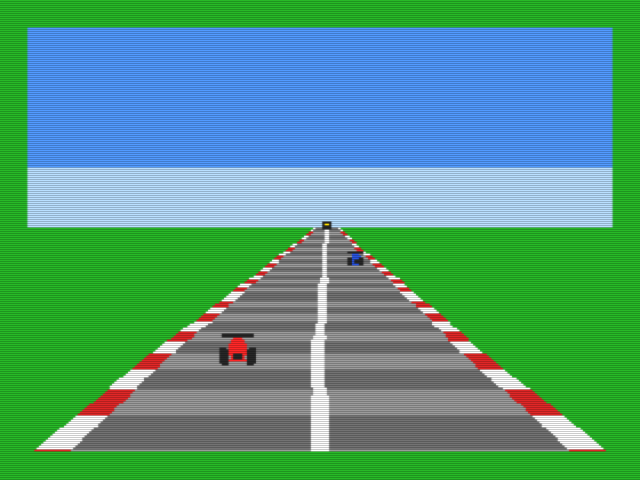
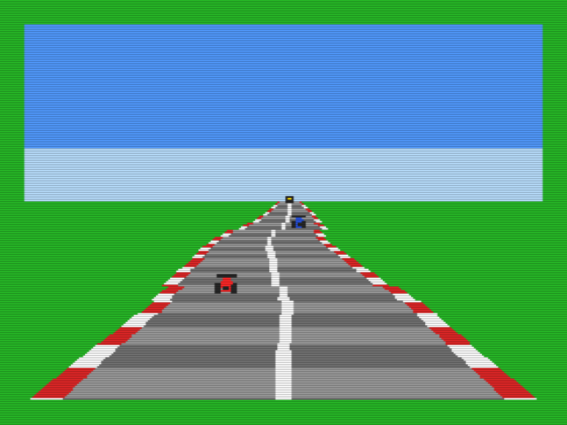

# Protótipo de pista pseudo-3D — MSX2+ (V9958), Z80 puro

Mede o que o V9958 aguenta para uma pista "por bandas" (sem scroll por linha).
**Dados 100% sintéticos e originais** (`gen_tables.py`); nada vem da ROM da Sega.



## Técnica
SCREEN 5 (256×212). Textura da pista em VRAM (página 3): 112 linhas × 2 variantes
de listra, desenhadas no boot com `LMMV`. Por quadro, 56 bandas de 2 linhas são
copiadas com `HMMM` para a página oculta (páginas 0/1 em duplo buffer); a curva
é um deslocamento X por banda (2 `HMMM` quando há curva). A fase das listras
vem de uma tabela 1/profundidade; o deslocamento de curva é `curva × q[banda]`.

## Como rodar
```sh
sudo apt install pasmo openmsx          # C-BIOS MSX2+ já vem com o openMSX
./build.sh 1 0x0180 road.rom            # args: vsync(0|1) velocidade saida.rom [tela_desligada]
openmsx -machine C-BIOS_MSX2+ -cart road.rom
```
Contador de quadros em `$C100` (word); o script `bench.tcl` mede quadros por
segundo em tempo **emulado** (`peek16 0xC100` entre t=8 s e t=18 s, pois a C-BIOS
leva ~3 s para iniciar). Para screenshots use `set frameskip 0` e capture após ~18 s.

## Resultados (openMSX 19.1, C-BIOS MSX2+; **medido em emulador, não em hardware real**)

| Teste | fps | Taxa de cópia/fill |
|---|---|---|
| Renderizador completo, 56 bandas, sem vsync | **11,8** | — |
| idem, tela desligada | 12,4 | — |
| 1× `HMMM` 256×112 (14 336 B) por quadro | 15,4 | ≈ 220 KB/s |
| 56× `HMMM` 256×2 (mesma área) | 14,0 | ≈ 200 KB/s |
| 1× `HMMV` 256×112 (fill por byte) | 25,0 | ≈ 360 KB/s |
| 1× `LMMV` 256×112 (fill lógico) | 6,3 | ≈ 90 KB/s |

## Conclusões
1. **O gargalo é a banda do VDP, não o Z80.** Copiar 14 KB/quadro custa ~65 ms.
   O custo por comando é pequeno (~5 ms por 56 comandos) e desligar a tela quase
   não ajuda. O Z80 gasta bem menos que o VDP e roda em paralelo.
2. O turbo R **não** acelera o VDP; só dá folga de CPU.
3. Para 30 fps o orçamento é ~7 KB copiados por quadro (metade da pista atual).
   `LMMV` deve ser evitado; `HMMV` é ~1,6× mais rápido que `HMMM`.

## Caminhos para ganhar desempenho (estimativas, a validar)
- **Listras por ciclo de paleta**: a textura carrega N tons de asfalto/grama e a
  animação é só girar a paleta (16 cores, custo de VDP ≈ 0).
- **Curva por zonas com R#27 + interrupção de linha (R#19)**: scroll horizontal
  por zona (8–14 zonas), sem copiar nada; curva "em degraus", barata em VDP, mas
  usa CPU nas interrupções.
- **Copiar só a janela suja** (asfalto + zebra + margem), e **reduzir a altura**
  da pista (ex.: 80–96 linhas).
- Alvo realista: 30 fps em retas e 15–20 fps copiando em curvas, ou 30 fps
  constante com o esquema paleta + zonas.


---

# Versão 2: paleta + zonas R#27 (`road_zones.asm`)



Resolve o gargalo medido acima: **nenhum comando de VDP por quadro**.

- **Textura estática**: a pista é desenhada uma só vez no boot.
- **Listras por ciclo de paleta**: 4 subfaixas por período; as entradas 4–15 da
  paleta (asfalto, zebra, faixa central) giram em 4 fases, reescritas no VBlank
  (24 bytes via `OTIR`). As listras avançam em direção à câmera.
- **Curva por zonas**: 17 zonas (4, 8 e 16 linhas; mais finas perto do horizonte).
  Uma interrupção de linha (R#19) por zona escreve **R#26/R#27** (scroll
  horizontal); `R#27 = s & 7`, `R#26 = ((7 - s) >> 3) & 31`. O scroll com
  *wrap* mostra grama dos dois lados, então a emenda é invisível. O fino
  scroll mascara à esquerda com a cor de fundo (R#7), por isso R#7 = grama.
- **IM2** (tabela de 257 bytes iguais + stub `JP` em RAM): trata VBlank e
  interrupção de linha sem passar pela BIOS (que não conhece o flag de linha).

```sh
./build_zones.sh 0x00A0 0 0 -1 zones.rom     # velocidade paldir forcecurve iladj saida
openmsx -machine C-BIOS_MSX2+ -cart zones.rom
openmsx -machine C-BIOS_MSX2+ -cart zones.rom -script zbench.tcl   # fps e folga de CPU
```

## Resultados (openMSX 19.1, C-BIOS MSX2+; **emulador, não hardware real**)

| Versão | fps | CPU livre |
|---|---|---|
| 1: 56 bandas com `HMMM` | 11,8 | — |
| 2: paleta + zonas R#27 | **60** (travado no VBlank) | **≈ 61 %** |

A folga é medida por um contador de voltas ociosas no laço principal, depois de
descontar interrupções e o cálculo por quadro (17 multiplicações + escrita das zonas).

## Limitações conhecidas / próximos passos
- Curva "em degraus" (visível perto do horizonte); dá para afinar com mais zonas
  (cada interrupção custa ~170 T).
- A animação das listras tem só 4 fases (8 exigiria mais entradas de paleta).
- Faixas mais finas que 1 linha (longe) usam um padrão `r % 4` (aspecto de névoa).
- **Relevo (subidas/descidas) ainda não implementado**: exigiria deslocar o horizonte
  e/ou escolher outra linha da textura por zona.
- Sprites (carros), HUD e colisão ainda não existem; o HUD pode ocupar linhas
  sem zonas.
- Falta validar em hardware real (tempo exato das interrupções de linha e IM2).


---

# Versão 3: curvas + relevo (`road_hills.asm`)

| Subida (+16) | Descida (−16) |
|---|---|
|  |  |

O relevo usa **R#23 (scroll vertical) por zona**, o equivalente no V9958 do scroll
vertical por linha do original: cada zona mostra outras linhas da textura.

- **Textura estendida**: 144 linhas (VRAM y = 100…243). Com R#23 = 16 o horizonte
  mostra a linha 16 da textura (pista plana); linhas anteriores são pista estreita
  (além da crista), as posteriores, pista larga.
- **Por zona**: `dv = relevo × q / 256` (−16…+16, mesmo fator quadrático da curva,
  zero perto da câmera) e `R#23 = 16 + dv`. Subida = `dv > 0` (pista chega larga ao
  horizonte); descida = `dv < 0` (a pista "some" atrás da crista).
- **Achado importante**: a interrupção de linha (R#19) compara com
  `linha + R#23`. Cada zona precisa agendar a próxima com
  `R#19 = linha_base + R#23_da_zona_atual`; sem isso a última zona sai desalinhada
  (teste com `ILV=0`).
- **Armadilha**: `NX = 0` no VDP significa 256 pixels. As linhas acima do horizonte
  geravam largura 0 e pintavam uma faixa cinza; a largura mínima é 2.
- Zonas passaram a ter 4 bytes (R#26, R#27, R#23, linha da próxima interrupção).

```sh
./build_hills.sh 0x00A0 0 0 0 1 -1 hills.rom    # speed paldir forcecurve forcehill ilv iladj saida
openmsx -machine C-BIOS_MSX2+ -cart hills.rom
```

## Resultados (openMSX 19.1, C-BIOS MSX2+; **emulador, não hardware real**)

| Versão | fps | CPU livre |
|---|---|---|
| 1: 56 bandas com `HMMM` | 11,8 | — |
| 2: paleta + zonas R#26/27 | 60 | ≈ 61 % |
| 3: + relevo (R#23) | **60** | **≈ 43 %** |

O custo extra vem da 2ª multiplicação por zona (17 × 2 ≈ 10 mil T por quadro) e da
ISR maior (3 registros por zona). Dá para recuperar CPU com uma tabela de
multiplicação ou calculando só quando curva/relevo mudam.

## Limitações
- O relevo é um deslocamento por zona (degraus de largura/posição perto do horizonte).
- Não há oclusão real de crista nem céu/horizonte que sobe e desce; o horizonte
  fica fixo na linha 100.
- Sprites, HUD, colisão e a leitura das pistas reais ainda não existem.


---

# Versão 4: pistas REAIS lidas da ROM do usuário (`road_track.asm`)

| Curva fechada (pos. 1121) | Subida à frente (pos. 676) |
|---|---|
|  |  |

A curvatura e o relevo deixam de ser sintéticos: vêm de uma das 16 pistas do
campeonato, lida da **sua** ROM de Super Monaco GP.

```sh
./build_track.sh "/caminho/Super Monaco GP (USA) (En,Ja).md" 0 40 0 track.rom [pos_inicial]
openmsx -machine C-BIOS_MSX2+ -cart track.rom
```
Args: ROM, pista (0–15), velocidade (fração de posição por quadro, 0–255), direção
da paleta (0|1), saída e posição inicial (opcional).

**Dados da ROM não são versionados**: `tools/smgp/export_track.py` gera
`track.inc` localmente (está no `.gitignore`, assim como `*.rom`). O repositório só
contém o código conversor.

## Como os dados são usados
- Cada pista = 1520–1936 **posições**. `export_track.py` expande os 3 fluxos do
  formato original (veja `notes/`) em dois vetores `int8` por posição:
  - `trkc`: curvatura = `±V/L × 18` (sentido pelo bit 6 do flag), suavizada em 7 posições;
  - `trkh`: altura relativa × 2 (descida/subida pelo bit 6; a volta **fecha em 0,0** nas 16 pistas).
- O jogador avança `pfrac` por quadro; ao completar 256, `pos++` (com volta ao início).
- **Olhar adiante por zona** (`zt3`): cada zona lê a pista `adiante` posições à frente
  (0 perto, ~47 no horizonte). Curva: `s = trkc[pos+adiante] × q >> 9`. Relevo:
  `dv = (trkh[pos+adiante] − trkh[pos]) >> 2`, limitado a ±16. Assim o horizonte já
  mostra a curva/subida que ainda vai chegar.
- A fase da paleta vem de `pfrac`, então as listras avançam junto com o carro.

## Resultados (openMSX 19.1, C-BIOS MSX2+; **emulador, não hardware real**)
**60 fps, ≈ 46 % de CPU livre**; a posição percorre a pista continuamente
(≈ 9,4 posições/s com `speedf = 40`).

## Aproximações e limitações
- A curva é uma **aproximação** (amostra da curvatura à frente), não a dupla
  integral do original; em curvas fortes (`|c|` satura em 127) a forma é mais
  "dobrada" que a real.
- O terceiro fluxo (zonas) e os bits baixos do flag (classe de raio) não são usados.
- A convenção "bit 6 = esquerda" é uma suposição; a pista pode sair espelhada.
- Sem sprites, HUD, colisão, nem os cenários (placas, túneis) do original.


---

# Versão 5: sprites de carros adversários (`road_cars.asm`)

| | |
|---|---|
|  |  |

Pista real (v4) + 3 carros adversários. **Arte 100 % original** (carro de corrida
genérico visto por trás, gerado em `gen_cars.py`), sem personagens nem gráficos da Sega.

```sh
./build_cars.sh "/caminho/Super Monaco GP (USA) (En,Ja).md" 0 40 0 cars.rom [pos_inicial]
openmsx -machine C-BIOS_MSX2+ -cart cars.rom
```

## Como funciona
- **Sprites modo 2 (SCREEN 5), 16×16**: cada carro usa 2 planos sobrepostos
  (escuro: asa/pneus/câmbio, por cima; corpo colorido por linha). 4 tamanhos
  (16, 11, 7 e 4 px) escolhidos pela distância. Tabelas BIOS: atributos `$7600`,
  cores `$7400`, padrões `$7800`; por isso a textura foi limitada a 132 linhas
  (as linhas 232+ da página 0 ficam livres para os sprites).
- **Projeção por tabelas**: distância em 1/4 de posição → linha da base (`ytab`),
  tamanho (`sizetab`) e zona (`zlinetab`). O X vem da faixa do carro × meia
  largura da pista na linha **+ deslocamento de curva da zona** (os sprites não
  acompanham o scroll R#26/R#27, então somamos `s` à mão). A fórmula usa o R#23 da
  zona para achar a linha certa da textura (largura da pista).
- **Atributos enviados no VBlank** (ISR, 28 bytes por `OTIR`), nunca no laço
  principal, para não colidir com o uso da porta de controle pelas interrupções.
- **Paleta reorganizada**: 0 céu (com `TP=1` no R#8: sem isso a cor 0 é
  transparente e mostra a cor de fundo), 1 névoa, 2 grama, 3 azul, 4–7 asfalto e 8–11
  zebra (giram), 12 vermelho, 13 escuro, 14 amarelo, 15 branco. A faixa central
  agora é uma linha branca **contínua estática** (as cores dos carros precisaram dos índices).
- Os carros avançam na pista com velocidades diferentes, dão a volta e somem quando
  ficam a mais de 63 posições ou atrás do jogador.

## Resultados (openMSX 19.1, C-BIOS MSX2+; **emulador, não hardware real**)
**60 fps, ≈ 37 % de CPU livre.** Execução longa de 240 s emulados (14 mil quadros)
sem travar; as posições dos carros dão a volta na pista corretamente.

## Limitações
- Sem colisão, ultrapassagem real, nem IA; os carros só andam em linha reta na faixa.
- Prioridade entre carros sobrepostos segue a ordem dos planos (não a profundidade).
- 4 tamanhos de sprite ⇒ "saltos" visíveis ao se aproximar; a linha de base é suave.
- Os sprites não acompanham o relevo dentro de uma mesma zona (usam a linha da tabela).
