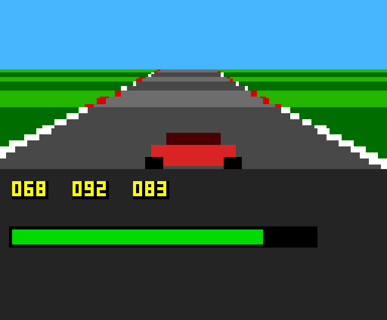

# Protótipo da estrada de Street Rod para MSX2

Pista pseudo-3D (projeção por segmentos, modelo extraído de `SRSE.EXE`, ver `../../NOTES.md`) em
**Screen 5 (256x212, 16 cores), V9938**, com 2 páginas de VRAM e troca no vblank. Código 100% próprio
(C/SDCC + Z80 assembly). Os gráficos do original (cockpit, carro) **não** estão no repositório: `gen_assets.py` os extrai do `LIB2` da *sua* cópia
do jogo (`LIB2=.../LIB2 ./build.sh`) e embute na ROM. Sem `LIB2` o jogo roda com gráficos simples. ROM de 32 KB (código em 0x4000, assets LZ em 0x8000).



## Controles (jogável)
| Tecla / joystick 1 | Ação |
|---|---|
| ↑ | acelerar |
| ↓ | frear |
| ← / → | direção |
| ESPAÇO ou botão A | subir marcha (câmbio manual) |
| SHIFT ou botão B | descer marcha |

Câmbio automático (carros com câmbio "Auto") troca sozinho. Fora da pista (|P| > 950) o motor perde potência. A zebra e
a pista seguem as curvas da pista de teste. `-DAUTOPILOT=1` liga o piloto automático (usado nos benchmarks).
Teste automatizado dos controles no openMSX: `control_test.tcl` (acelera, troca marchas, vira e freia).

## Corrida (arrancada contra um oponente)
- **Largada:** semáforo (vermelho, vermelho, verde em 3 s). Engatar a 1ª marcha antes do verde = **largada falsa** (derrota).
  Depois do verde a 1ª marcha entra sozinha ao passar de 2900 rpm. Câmbio automático em carros "Auto".
- **Pista:** 380 segmentos (arrancada, como no original). Vence quem cruza primeiro.
- **Resultado:** tela com `YOU WIN`/`YOU LOSE`, tempo (décimos de segundo), velocidade média; ESPAÇO reinicia.
- **Oponente:** mesmo modelo de carro/peças do jogo; câmbio manual troca em `rotação de corte - 100*habilidade` (parâmetro `a` do
  piloto, 20 = Mike ... 10 = The King), alivia nas curvas e não deixa a vantagem passar de ~9 segmentos (IA simplificada do original).
  Aparece na pista a partir de 2 segmentos à frente, na faixa da direita.
- Escolha: `CAR=17 OPP_CAR=12 OPP=0 SRSE_EXE=... HOT_DATA=... ./build.sh` (`OPP_CAR`: carro do oponente; `OPP`: piloto 0-21).
- Testes automatizados no openMSX: `race_test.tcl` (corrida com piloto automático `-DAUTOPILOT=1`) e `race_manual.tcl`
  (largada falsa → reinício com ESPAÇO → corrida completa com trocas manuais).
- Medido: ~9,5 fps com oponente na pista (janela 192x80). Corrida de exemplo (Thunderbird vs Mike): vitória em 21,7 s, média 99 mph.

## Como rodar
```
sudo apt install sdcc openmsx xvfb          # + C-BIOS (já vem com o openmsx)
CAR=17 SRSE_EXE=SRSE.EXE HOT_DATA=HOT_DATA ./build.sh   # gera road.rom (janela 192x80, modo 2, passo 4)
./bench.sh "-DDRAW_MODE=2 -DSTEP_SH=2" saida.png   # mede fps no openMSX (C-BIOS MSX2, 60 Hz) e salva a tela
./matrix.sh < configs.txt                    # várias configurações (linha: descricao|flags)
```
Flags: `DRAW_MODE` (0 = gramado em retângulo por faixa + zebra/pista; 2 = cada pixel pintado 1x;
4 = só pista, supõe fundo estático), `STEP_SH` (log2 de scanlines por retângulo), `VIEW_BOT`,
`VIEW_X0/X1` (janela), `DRY` (não emite comandos ao VDP: mede só a CPU).

## Física do carro (modelo real do jogo)
`gen_tables.py` lê o modelo de desempenho extraído do EXE (`../../tools/powertrain.py`) e gera as tabelas de marchas/curva de
torque do carro escolhido: `CAR=17 SRSE_EXE=... HOT_DATA=... ./build.sh ...` (sem os arquivos usa uma curva padrão).
A física roda a **6,0688 Hz** como no original (72,826/12 Hz) e a pista avança como o original a ~8,09 fps equivalentes.
Medido no openMSX (câmbio automático simples):

| Carro | 0-60 mph | 0-100 mph | máxima |
|---|---|---|---|
| 1960 Ford Thunderbird | 3,6 s | 6,6 s | 117 mph |
| 1953 Buick Skylark Conv. | 3,9 s | 7,5 s | 115 mph |
| 1934 Ford Woodie | 4,4 s | 8,3 s | 108 mph |
| 1939 Pontiac 2-dr coupe | 16,7 s | - | 81 mph |

(a simulação em Python `tools/physsim.py` prevê 3,2 s / 16 s para Thunderbird / Pontiac)

## Medições (openMSX, tempo emulado, 20 s)
O original ficava limitado a **~8 fps** (relógio de 72,8 Hz, 9 ticks por frame).

| Janela | Modo | fps | só CPU (DRY) |
|---|---|---|---|
| 256x112 | gramado por faixa, passo 4 | 7,1 | 15,0 |
| 256x112 | só pista (fundo estático), passo 4 | 8,4 | 17,8 |
| 192x80 | pixel 1x, passo 4 | 10,1 | – |
| 192x80 | só pista, passo 4 | 12,1 | – |
| 192x80 | só pista, passo 2 (mais suave) | 11,3 | – |
| 160x56 | pixel 1x, passo 4 | 14,1 | 22,9 |
| 160x56 | só pista, passo 4 | 16,1 | – |

Primeira versão em C puro: **3,4 fps** (janela 256x112).

## Custos medidos
- VDP: `HMMV` ≈ **2,76 µs/byte** (≈ 360 KB/s) e ≈ 160 µs de emissão por comando. Janela 256x112 pintada uma vez
  = 14,3 KB ≈ 40 ms só no VDP.
- CPU (Z80 3,58 MHz, openMSX): `project` (15 linhas) ≈ 13 ms; laço das faixas ≈ 33 ms; física (7 ticks) ≈ 6 ms.
- SDCC: multiplicação `long` ≈ 4,9 mil ciclos; foi substituída por rotinas em assembly (16x8 e 16x16).

## Lições (armadilhas)
- IX é o ponteiro de frame do SDCC: rotinas em assembly devem preservá-lo.
- Zerar a BSS no crt0 (flags com lixo desligaram o VDP e mascararam as medições).
- Escritas em pares no VDP (`R#17`, status) precisam de DI/EI curtos; a ISR da BIOS lê o status 0.
- `jr` não alcança rótulos distantes no assembler do SDCC; usar `jp`.

## Próximos passos de otimização
1. Física/projeção/laço em assembly puro (hoje ~50 ms de CPU por frame; dá para ~25 ms).
2. Gramado por rotação de paleta (só a pista é repintada) -> linha "só pista" da tabela.
3. Emitir menos registros por comando; juntar DI/EI do polling.
4. Janela do tamanho do para-brisa original (≈ 205x45): ~16 fps medidos com 160x56.
5. MSX turbo R (R800): CPU ~5-10x; o VDP continua igual, então o limite passa a ser o `HMMV`.

## Gráficos do original (cockpit)
- `gen_assets.py`: lê o item 14 da `LIB2` (cockpit 320x190), reduz para 256 colunas (descarta 1 coluna em 5, preservando o dither), mapeia as cores EGA
  para a paleta MSX2 (`palette_def.py`) e comprime em faixas de 4 KB (LZ4-like, decodificador Z80 de ~60 bytes em `vdpasm.s`). Também gera o carro
  visto por trás (item 248, fundo transparente por flood-fill) em 9 tamanhos, os ponteiros dos mostradores e `assets.h`.
- Na carga a tela é apagada e as faixas vão para a VRAM: cockpit nas páginas 0 e 1 (as duas telas) e uma cópia limpa na página 2; sprites na página 3.
- A estrada é desenhada só no vidro (x 0..256, y 46..94: termina na linha do capô, com as linhas ciano e o painel sempre intactos). A moldura da esquerda (porta/coluna A) é recopiada por cima em ~14 retângulos HMMM. Tacômetro e velocímetro: a cada mudança, `HMMM` restaura o fundo
  limpo (página 2) e `LINE` desenha o ponteiro; o oponente é um `LMMM` com TIMP (cor 0 transparente) da folha de sprites.
- A ROM de 32 KB usa ENASLT no início para mapear o cartucho também na página 2 da CPU.
- `./shot.sh "<flags>" "t1 t2" prefixo` salva capturas de tela (VRAM→PNG) no openMSX.

## Semáforo e som
- Semáforo: item 13 do `LIB2` (duas cabeças de 24x32) em 3 estados gerados por recolorização (apagado, vermelho, verde), copiado por HMMM da folha de
  sprites; some ao fim de ~2 s da largada (a região é restaurada da cópia limpa do cockpit).
- Som no PSG (escrita direta nas portas 0xA0/0xA1): motor = 2 tons (canais A/B) com frequência `rpm/15` Hz e volume maior com acelerador; bipes do
  semáforo no canal C (2 graves e 1 agudo e longo na largada). O mixer escreve `0xB8` (bit 7 = porta B como saída, necessária à BIOS para ler joystick).

## Menu de seleção (carro, oponente, piloto)
Depois da tela de título aparece o menu: ↑/↓ escolhe o campo (seu carro / carro do oponente / piloto) e ←/→ troca o valor (segurar repete); ESPAÇO
inicia. Ao fim da corrida, ESPAÇO volta ao menu. Os 26 carros e 22 pilotos vêm de `HOT_DATA`/`SRSE.EXE`: `gen_tables.py` gera `cars.h` com as marchas,
curvas de torque e linha vermelha de cada carro (modelo `tools/powertrain.py`) e a habilidade do piloto; o oponente troca de marcha em
`rotação de corte - 100*habilidade`. Vista traseira do oponente: 3 modelos (sedã genérico, perua/woodie, Corvette) e cor de pintura sorteada
(cor 12 da paleta). Os assets ficam no fim da ROM de 32 KB (hoje ~0,3 KB de folga: próximo passo é uma ROM maior com mapper).

## ROM com mapper ASCII16 (64 KB)
- Layout: banco 0 (0x4000, fixo) + banco 1 (0x8000, padrão) = código e tabelas (até 32 KB); bancos 2+ = assets comprimidos (16 KB cada), que só são
  mapeados em 0x8000 pelo carregador (`load_assets` em `vdpasm.s`, junto com `lz_unpack`/`vram_blit`, tudo na página 1 fixa: o linker coloca `vdpasm`
  primeiro). A faixa de assets nunca cruza dois bancos (`gen_assets.py`).
- `crt0.s` escreve 0 em 0x6000 e 1 em 0x7000. As escritas a 0x6000/0x7000 fazem emuladores (openMSX, WebMSX) detectarem ASCII16; se o seu não detectar,
  escolha o mapper "ASCII16" ao carregar a ROM.
- Para adicionar assets basta chamar `add()` em `gen_assets.py`: novos bancos são criados automaticamente (a ROM cresce em potências de 2).

## Hub / garagem (marco M1)
Título → ESPAÇO → **garagem** (cena do `LIB2` item 32, paleta EGA própria carregada em `load_garage`; a cópia limpa fica na página 2 para o menu poder ser apagado
com HMMM). Barra de status: dinheiro, data (agosto-setembro de 1963) e carro atual. Menu: YOUR CARS (escolher o carro, até 4), NEWSPAPER (em breve),
BOBS DRIVE-IN (escolhe oponente e piloto, corre, o resultado altera dinheiro/dia: +$50 vitória, -$25 derrota; provisório) e QUIT GAME (volta ao título).
Estado: `money`, `day`, `own[4]`, `cur` (`new_game()` começa com $1000 e um Lincoln Capri 1957). Assets em grupos: 0 = corrida, 1 = garagem (`g_group`).
Testes: `hub_test.tcl` (percorre as telas e salva capturas) e `loop_test.tcl` (hub↔corrida em loop, `-DRACE_LEN=40 -DAUTOPILOT=1`).

## Jornal (marco M2)
Menu NEWSPAPER: **USED CARS** (6 ofertas por dia, sorteio determinístico por dia com preço 80–120% do preço de tabela e sempre uma pechincha entre os
carros mais baratos; compra ao preço pedido ou com oferta de 10/20/30% a menos, que o vendedor aceita com chance 80/50/15%, senão a oferta some no dia),
**AUTO PARTS** (43 peças do `HOT_DATA` por categoria: motores, câmbios, carburadores, coletores, pneus; até 12 peças avulsas) e **SELL SPARE PARTS** (metade do
preço). O jogo começa sem carro ($1000): Bob's Drive-In e a lista de carros avisam "buy a car first". Mensagens no estilo do original
("NO GO, HOT SHOT / YOU ARE $x SHORT", "IT'S YOURS!"). Limite de 4 carros. Testes: `news_test.tcl`/`news_test2.tcl` (`-DSTART_MONEY=6000`),
`-DSTART_CAR=16` dá um carro inicial para os testes de corrida (`loop_test.tcl`).
Detalhe de ROM: `ihx2rom.py` falha se a ROM tiver o byte-padrão `LD (nn),A` para registradores de banco de outros mapper (ex.: `32 00 50`),
porque o openMSX/WebMSX os usam para adivinhar o mapper; a tabela de preços das peças guarda `preço+1` por isso.

## Garagem (marco M3)
YOUR CARS → escolher um carro → **DRIVE THIS CAR** (carro com que corre), **CAR PARTS** (troca peça por categoria usando as peças avulsas compatíveis com a
montadora do carro; a peça antiga vai para o estoque), **TUNE TIMING** (retard/advance, mostra a potência), **CAR INFO** (potência, marchas, rotação máxima,
câmbio, desgaste, ponto) e **SELL IT** (o revendedor oferece 55% do valor; pedir 20% ou 40% a mais é aceito com chance 55%/20%). O carro atual é marcado com `*`.
O desempenho vem do modelo do jogo (`tools/powertrain.py`) portado para inteiros em `ptmodel.h` (`pt_quality`/`pt_power`/`pt_build`), recalculado na
largada com as peças instaladas, o desgaste e o ponto (dano ainda não usado). Verificado contra o Python: 14.580 combinações no PC (erro ≤ 1 unidade) e
casos no próprio Z80 via `pt_dbg.c` (compilar à mão: `sdcc ... pt_dbg.c`, ler 0xF000.. no openMSX). Obs.: o SDCC gerou código errado para a expressão
composta do desgaste/ternário em `i32`; o código foi reescrito em passos simples (ver comentário em `ptmodel.h`).
Testes: `garage_test.tcl` (compra peça, troca, CAR INFO) e `sell_test.tcl` (venda).

## Bob's Drive-In (marco M4)
BOBS DRIVE-IN → **CHALLENGE WHO?** (22 pilotos, de Mike a The King) → o jogo mostra o piloto e o carro dele (carro sorteado na classe de desempenho que cresce com o
nível do piloto) → **tipo de corrida**: DRAG RACE (reta e plana, 380 segmentos), ROAD RACE (pista com curvas e ladeiras, 520), JUST FOR KICKS (sem aposta) e
PINK SLIPS (o carro de um contra o do outro; exige vitórias: `1 + índice/2`; o oponente aceita com chance de 70%) → **aposta** $10/$25/$50/$100 (o oponente aceita
com chance 100-15*nível; falta de dinheiro avisa) → corrida. Depois: vitória soma a aposta, derrota desconta; pink slip transfere o carro (se não houver vaga,
vende por metade do valor); mensagens do original ("BIG DEAL.", "YOU JUST WON A HELLUVA CAR!", "YA JUMPED THE LIGHT, SPEEDY!"). Cada corrida passa 1 dia.
Detalhes: a pista (`curve_ram`/`hill_ram`, lidos por `proj.s`) é escolhida na largada; os nomes (carros, peças, pilotos) vivem num banco da ROM e são
copiados por `bank_copy` (rotina na página 1) — liberou ~1,7 KB de código. Testes: `loop_test.tcl` (LAPS=n), `bobs_test.tcl`, `pink_test.tcl`
(`-DSTART_CAR=17 -DSTART_MONEY=500 -DSTART_WINS=20 -DTEST_ACCEPT [-DTEST_LOSE]`). A decisão de aceitar apostas é uma regra simples minha; as tabelas do bloco
9/10/11 do HOT_DATA ainda não foram decifradas.

## Consequências e fim de jogo (marco M5)
- **Desgaste por corrida:** motor `+100 + 30·(ticks acima da rotação de corte)`, pneus `+6` (`+10` na estrada), gasolina `-3` galões (tanque de 20; Bob's exige 3).
- **Quebras** (a corrida vira derrota, a aposta se perde): motor `2% + 6%·ticks acima da rotação + desgaste/500`, câmbio `1% + 12%·trocas com o motor passado`, pneus pela
  tabela do jogo (`pm_wtire`, 5 níveis de desgaste por tipo de pneu). Carro quebrado não corre ("YOUR CAR'S NOT RUNNING, SPEEDY!").
- **Destruição:** perdendo a mais de 90 mph há 6% de chance de perder o carro (sucata = 10% do preço): "LUCKY YOU WEREN'T KILLED!".
- **Garagem:** no menu do carro, **FIX OR JUNK IT** ("DAMN. IT'LL COST $x": preço das peças quebradas; consertar zera o desgaste do motor/pneus; sucatear paga a sucata) e
  **GAS UP** (3 galões por dólar). CAR INFO mostra combustível, desgaste dos pneus e o que está quebrado.
- **Fim de jogo:** acabou o verão (dia 46 = 15 de setembro, circulado no calendário) → "YOU'RE DONE FER THE SUMMER!"; venceu The King numa corrida real → "YOU DESERVE TO BE KING OF THE COUNTY!";
  sem carro, sem peças e com menos de $300 → "YOU'RE OUTTA DOUGH.". Mostra o resumo (dinheiro, carros, vitórias) e volta ao título.
- Testes: `cons_test.tcl` (`-DTEST_BRK=1`: quebra de motor forçada, Bob's recusa, FIX IT), fim do verão com `-DSTART_DAY=59 -DTEST_BRK=0`.
Os números (percentuais, custos) são regras minhas inspiradas nas mensagens do original; a tabela de pneus é a do jogo.

## Infraestrutura de bancos de código (overlays)
A região fixa de código (32 KB) estava cheia; agora o código é dividido em **bancos ASCII16** (sem limite prático de tamanho da ROM):
- **Banco 0 = núcleo**, em 0x4000-0x7FFF (página 1, sempre visível): `crt0`, `vdpasm.s`, `proj.s`, tabelas, texto/UI, som, modelo do motor (`ptmodel.h`), bibliotecas do SDCC. Hoje ~13,3 KB de 16 KB.
- **Bancos 1..3 = código**, na janela 0x8000-0xBFFF (página 2). Hoje: banco 1 = corrida (física, projeção, sprites, HUD, `run_race`), banco 2 = jogo (título, garagem, jornal, Bob's, consequências, `hub`). Cada um tem 16 KB.
- **Bancos 4.. = assets** (`ASSET_BANK0=4`, variável de ambiente de `gen_assets.py`/`ihx2rom.py`) e o banco de texto.
- Como funciona: `main.c` continua uma só unidade de compilação; os `#pragma codeseg CODE|BANK1|BANK2` marcam as regiões do fonte. `build.sh` compila para
  assembly (`-S`), `bankify.py` redistribui funções/tabelas nas áreas `BANKn` (e **falha o build** se uma referência cruzar bancos sem passar por uma função
  `__banked`), e o `sdld` põe cada área em `0x{n}8000` (endereço virtual); `ihx2rom.py` reposiciona no arquivo da ROM. Chamadas entre bancos usam o `__banked`
  do SDCC (`BK` no fonte) com `___sdcc_bcall_ehl` + `get_bank/set_bank` (`vdpasm.s`; `_cur_bank` é restaurado pelos carregadores de assets/texto).
- Regras para novas funções: funções usadas por mais de um banco vão para o núcleo (`#pragma codeseg CODE`) ou são `BK`; **funções `BK` só recebem argumentos escalares**
  (um ponteiro para string/tabela de outro banco ficaria invisível). Para criar o banco 3 basta colocar `#pragma codeseg BANK3`.
- Verificado: `loop_test`, `cons_test`, `garage_test`, `sell_test` e `pink_test` dão os mesmos resultados de antes (diferenças só em sorteios, que dependem do tempo de boot).

## Rua (marco M6)
Em **BOBS DRIVE-IN** o jogo agora faz primeiro o trajeto: "CRUISING IN TOWN... MAX SPEED 45 MPH" e você dirige (mesma engine da corrida, pista com curvas, sem
oponente/semáforo, 420 segmentos) até o Bob's. Três **radares** (nos segmentos 110/230/350): acima de 45 mph a multa é `$5 + (mph-45)/4` por radar ("SPEEDING
TICKET(S)!", "FINE $x", descontada do dinheiro). **Gasolina:** 1 galão por trajeto (2 se a média passar de 50 mph); com menos de 3 galões depois do trajeto avisa
"YOU'RE LOW ON GAS!" e não abre o Bob's (a corrida gasta 3). **ESC/SHIFT** desiste e volta à garagem sem gastar. Implementado com `street_mode` em `run_race`
(BANK1) e `street_trip` (BANK2). Teste: `street_test.tcl` (`-DAUTOPILOT=1 -DSTART_CAR=16`). As multas e o consumo são regras minhas.

## Garagem clicável (M7, parte 1)
O menu principal virou a própria cena da garagem com um **cursor** (sprite 16x16 de 2 planos: miolo branco + contorno preto, padrões em 0x7800, cores 0x7400, atributos 0x7600 — a
sobra da página 0 da VRAM; `spr_put` em `vdpasm.s`). Setas/joystick movem (aceleram ao segurar), **ESPAÇO / botão A clica**, e um **mouse na porta 1** é lido via
`GTPAD` da BIOS (`read_mouse`; ativa só quando chega deslocamento sem direção do joystick — não testado em mouse real, o openMSX não injeta movimento).
Objetos (retângulos em `hot[]`, o nome aparece no alto da cena): prancheta e macaco = **YOUR CARS**, jornal no chão = **NEWSPAPER**, calendário = datas/dias
restantes, rádio = **CATCH SOME TUNES** (jingle de 8 notas no PSG), galão verde = **WANNA TANK?** (gasolina), abertura da garagem à esquerda = **HIT THE STREET**
(rua → Bob's), relógio = **TIME TO QUIT** (confirma). Sprites só ficam ligados no hub (R#8 bit 1); nos menus/notas o cursor some.
Testes automáticos: `-DOLD_MENU -DSKIP_STREET` recompõe o menu de texto antigo e pula a rua (todos os `*_test.tcl` antigos); `click_test.tcl`/`click2_test.tcl`
(`-DCUR_X/-DCUR_Y` posicionam o cursor) e `vram2png.py ... garage spr` (renderiza os sprites; o `screenshot` do openMSX sai preto em modo sem throttle).
Pendente no M7: telas de título/jornal/Bob's/resultado com a arte da LIB1/LIB2, o carro desenhado na garagem, pintura/adereços, música, ranking.

## O carro na garagem (M7, parte 2)
O carro atual aparece desenhado na garagem: corpo lateral (LIB2: itens 39…201, escolhidos pelo `pic_index` do HOT_DATA; figura 255 = Plymouth conversível = item 179, 26º = Corvette 201)
+ duas rodas (tipo de pneu: 28 = faixa branca, 65 = cromada, 106 = slick), tudo com a largura reduzida a 4/5 como a cena (`cars_art.py`). A posição das rodas vem da detecção dos vãos
das arcadas (3 carros têm posição manual). As imagens usam a paleta da cena: **índice 0 = transparente (LMMM TIMP), 6 = pintura, 7 = reflexo** (6/7 não são usados pela cena, então
`set_paint` troca só essas duas cores — cada carro tem `paint` 0..7 = a paleta de pinturas do oponente). Cada carro é um grupo de assets (2+id), cada pneu outro (28+tipo), descomprimidos
no rascunho da página 3 (`CAR_Y0`/`WHEEL_Y0`); `draw_car` copia a faixa limpa do chão (guardada em `BAND_COPY_Y` por `band_save`) para as páginas 0-2 e compõe o carro por cima (a página 2
continua servindo de cópia para `hub_restore`). É redesenhado ao voltar de qualquer ação do hub (troca/compra/venda/conserto). O carro é clicável (= YOUR CARS). Nota: o banco 2 de código
está com ~14,5 KB de 16 KB — o próximo grande bloco de código deve ir para um BANK3 (`#pragma codeseg BANK3`).

## Fonte e janelas da garagem; entrada/saída do carro (M7, parte 3)
- **Fonte:** na garagem o texto agora usa a fonte 6x8 da BIOS (tabela `CGTBL`, ponteiro em 0x0004; `font_init` copia as 96 letras para a página 3 da VRAM, em preto e em branco, ao carregar a cena)
  e `gtext` desenha letra a letra com LMMM (TIMP). Minúsculas/símbolos existem na fonte; o jogo ainda manda os textos em maiúsculas. A fonte 3x5 em 2x2 continua só nas telas de corrida/título.
- **Visor:** a barra branca no alto da cena mostra o nome do objeto sob o cursor (texto preto centralizado). **Barra de status** branca com texto preto (dinheiro, data, carro; "ESC BACK" à direita nos submenus).
  **Janelas:** moldura preta, fundo branco, título sublinhado, linhas de 12 px, item selecionado = barra preta com texto branco; os textos cabem nas janelas (até ~36 letras).
- **Carro:** base das rodas no chão (y=190). Ao trocar de carro: garagem vazia → o carro novo entra pela esquerda; garagem cheia → o antigo sai de ré (para a esquerda) e o novo aparece no lugar.
  A animação desenha na página oculta e troca a página (sem cintilação), 8 px por quadro (`car_slide`). `new_game` zera `shown_id`; ao voltar de uma corrida o mesmo carro não é reanimado.

### Ajuste de posição do carro (referência: captura do jogo original)
Base das rodas em y=152 (`CAR_FLOOR`), centralizado, com sombra elíptica preta sob o carro (`cshadow`); faixa de restauração y=80..164 (`BAND_Y/BAND_H`); rascunho da página 3 em `CAR_Y0=856`/`WHEEL_Y0=930`.
Os objetos do chão (jornal, macaco, compressor, galão) ficam livres abaixo do carro, como no original.

## Pintura e adereços (M7, parte 4)
Clicar no **compressor roxo** (chão, à direita) abre **PAINT AND BODY**: **NEW PAINT JOB $20** (12 cores: as 8 do jogo + preto, branco, rosa, marrom; o índice 6 da paleta é a pintura e o 7 o reflexo),
**STICKERS $5** (8 adesivos da LIB2, itens 186-193, desenhados na porta), **CHOP ROOF / REBUILD ROOF $70** (teto rebaixado) e **STRIP / RESTORE BUMPERS $15**. Uma compra por visita; o carro é
redesenhado ao sair. O `Car` ganhou `roof`, `bump`, `stick` (e `paint` 0..11). Os preços são os das strings do original; as cores e adesivos são escolhas minhas.
**Variantes:** `cars_art.py` gera 4 corpos por carro (`variants`: teto rebaixado = tira linhas dos montantes entre a capota e a cintura; sem para-choques = apaga o cromado nas pontas) — grupos de assets
2+id (normal) e 100+3·id+v-1; adesivos = grupos 180+n; página 3 da VRAM: 768 cópia limpa da faixa, 852 corpo, 920 roda, 948 adesivo, 976 fonte.

### Reorganização dos bancos
O núcleo estava estourando (a ROM só roda com o núcleo em 0x4000-0x7FFF). Agora: **BANK1** (corrida) também leva as rotinas em assembly da estrada (`strip_run`, `draw_road_asm`, `mul12`, `mul16x8`, `project_asm`:
áreas `BANK1` dentro de `vdpasm.s`/`proj.s`) e as **tabelas da estrada** (`tables.h` tem `#pragma codeseg BANK1`; `bankify.py` agora lê os `#pragma` dos cabeçalhos); **BANK3** = Bob's, fim de corrida/jogo e a oficina;
`ASSET_BANK0` = 6 (bancos 1..5 livres para código). Núcleo: 13,2 KB de 16 KB. A ROM tem 512 KB (as 4 variantes × 26 carros + adesivos viraram ~11 bancos de assets).
`street_test.tcl`/`body_test.tcl` (`-DCUR_X/-DCUR_Y` no compressor) são os testes desta parte.

## Jornal com a arte original (M7, parte 5)
Clicar no jornal no chão da garagem mostra a **primeira página do "Los Angeles News"** (LIB2 item 21, 320x136 → 256x136) com a **manchete do dia** (itens 22-26, 54 linhas; `day % 5`) — 190 linhas no total.
Cursor como na garagem: **AUTO PARTS** (faixa de cima) e **USED CARS** (faixa do meio) abrem as listas de sempre (janelas brancas sobre a página); o **título "Los Angeles News"** vende peças avulsas;
o nome do objeto aparece numa etiqueta no pé da página; **ESC** volta (recarrega a garagem). `pick_hot` virou o seletor genérico de objetos (`hs/hn/hnames/lab_mode`). Grupos de assets 190 (página) e 191-195 (manchetes).
**Bug corrigido:** o carregador de assets contava as faixas em 8 bits (`djnz`); com 261 faixas só as 5 primeiras eram lidas — agora usa contador de 16 bits.
Outros itens de arte já localizados na LIB2 (para as próximas telas): 90 (posto "Gus' Gas"), 93 (**Bob's Drive-In**), 219/221 (calendários JUN-JUL e AUG-SEP), 15 (carteira de motorista DMV), 16 (livro da Highway Patrol), 14 (cockpit).

### Jornal: sem a faixa de manchetes
A faixa inferior (manchete do dia, itens 22-26) foi retirada: o texto dela é pré-renderizado ilegível e competia com a etiqueta e a barra de status. A página (item 21) fica no alto e o resto da tela é preto
(grupo 190; os grupos 191-195 deixaram de existir).

### Animação do carro sem piscar a barra de status
A animação alterna as páginas 0 e 1; a barra de status só existia na página 0 e "piscava" a cada quadro. `hub_status` agora desenha a barra nas **duas** páginas, e o hub a chama **antes** de `draw_car`.
`cshadow` também recorta a sombra fora da tela (carro entrando/saindo).

### Jornal: texto legível (revisão)
Voltou o layout do original (página 21 + manchete do dia 22-26 embaixo, sem o fundo preto) e **sem etiqueta repetida** no pé (as faixas já dizem o que são). Os "rabiscos" ilegíveis do corpo de cada coluna
(microtexto pré-renderizado na arte) são apagados na geração (`NEWS_BODY_TOP` em `gen_assets.py`; filete entre as colunas) e o jogo escreve um texto curto **legível com a fonte da garagem**
(`news_body[]`, 2-4 linhas de até 20 letras, desenhado na cópia da página 2 e copiado para a tela). As manchetes (fonte grande da arte) ficam como no original.
Obs.: o clique no título "Los Angeles News" (vender peças avulsas) não tem etiqueta.

## Tudo pelo mouse (M7, parte 6)
- **Listas/janelas** (`ui_list`): o cursor (sprite) aparece assim que o mouse se mexe; **passar o cursor seleciona a linha, o botão esquerdo escolhe**; botão **X** na barra de título (volta; o menu raiz não tem) e **▲▼ ("^" e "v")**
  para rolar listas longas; botão direito/ESC/SHIFT também voltam. Teclado/joystick continuam iguais (setas + ESPAÇO).
- **Jornal:** a barra de status vira **[SELL PARTS] [EXIT]** (botões clicáveis; o cursor pode descer até a barra); os títulos AUTO PARTS / USED CARS / "Los Angeles News" continuam clicáveis.
- O cursor/mouse (`mouse_move`, `cursor_init`, `spr_on/off`) foi para o núcleo (usado pela garagem, jornal e listas). `-DTEST_MOUSE` simula o mouse nos testes (setas = deslocamento, ESPAÇO = botão); `mouse_test.tcl`, `mouse2_test.tcl`.
- `bankify.py`: literais de string agora vão para o banco das funções que os usam (antes dependia da ordem do arquivo) e `decl_line` reconhece `static const char *const x[]`.
- Núcleo: 15,4 KB de 16 KB — o próximo recurso grande deve mover algo para um banco.

### Rodas centralizadas nas arcadas
`cars_art._refine`: depois da detecção grosseira, o centro x de cada roda é recalculado pelo vão da arcada (flood-fill dos pixels transparentes a partir do centro, limitado a ±24 px; centro = meio do vão à
altura do meio da roda), com ajuste máximo de ±8 px; o y não muda (carros com arcadas abertas, como o Lincoln, ficavam com a roda baixa demais).

### Rodas: dianteira também
A medida pelo flood-fill era limitada e só acertava a traseira. Agora `cars_art._arch` mede a largura da arcada pelo "teto" de cada coluna (primeiro pixel do corpo subindo a partir da base da roda; a arcada = colunas cujo teto está acima do centro da roda) e centraliza a roda;
medidas implausíveis (largura fora de 22..52 px ou deslocamento > 10 px) são ignoradas (posição anterior). A roda dianteira andou ~8 px para a frente na maioria dos carros.

### Roda dianteira: ajuste visual
A dianteira (lado direito) fica `FRONT_BACK = 4` px atrás do centro medido da arcada (`cars_art.py`), pedido por revisão visual; para ajustar mais/menos, mude esse valor e rode `build.sh`.
A traseira (lado esquerdo) fica `REAR_FWD = 4` px à frente do centro medido, em todos os carros (inclusive os de posição manual).

## Bob's Drive-In com a arte original (M7, parte 7)
Depois da rua, aparece a **lanchonete** (LIB2 item 93, grupo 197): clique no cara encostado, nos carros ou no botão **CHALLENGE** da barra de status para abrir o desafio (as listas de sempre, agora sobre a arte do Bob's);
**EXIT**/ESC/botão direito voltam à garagem. O nome do alvo ("LOOK FOR OPPONENT") aparece na faixa preta sob a lanchonete. O fluxo de aposta/corrida (`bobs()`, BANK3) não mudou; `bobs_front()` (BANK2) é a tela.
`bar_news` virou modo da barra de status (1 = jornal, 2 = Bob's). Teste: `bobsfront_test.tcl` (`-DSKIP_STREET -DCUR_X=20 -DCUR_Y=100`).

### Bob's: o oponente chega sozinho, igual ao carro da garagem (revisão)
Um carro de cada vez, **com o mesmo desenho lateral da garagem** (`car_art`/`car_blit`/`car_slide`: corpo + rodas + sombra): **entra deslizando pela esquerda** até o centro, fica **parado 8-12 s** com a cabeça do piloto
na janela (`bob_head`) e, se ninguém o desafia, **sai para a frente (direita)**; 2-4 s depois chega outro (piloto aleatório diferente, carro da classe dele, cor aleatória = índices 6/7 da paleta).
**Clique na cabeça** (ou passe o cursor: o nome aparece na barra de status): janela com o nome, o carro e **CHALLENGE / NOT NOW** → tipo de corrida e aposta (`bobs_race`, BANK3). A cena do Bob's (item 93)
teve os dois carros pintados apagados na geração (copiando faixas limpas da parede/meio-fio/asfalto); a página 2 fica limpa (sem o carro) para restaurar as janelas. Animação com troca de página, como na garagem.
`pick_hot` ganhou `pick_tick` (função chamada a cada quadro). O fluxo de texto antigo (`bobs()`) continua para os testes. Teste: `bobsfront_test.tcl` (`-DBOB_CUR_X/-DBOB_CUR_Y` posicionam o cursor na cabeça).

### Bob's: cenário intacto e retratos dos pilotos (correção)
Os carros pintados (verde e vermelho) e o cara encostado **são cenário** (voltaram; só o oponente entra/sai). As **cabeças dos pilotos** são os retratos da LIB2 (itens 194-199 e 202-217 = 22 retratos, um por piloto, grupos 220+piloto):
`car_blit` desenha o retrato por baixo do corpo, então ele aparece só pela janela (como no original). Posição: atrás do meio do carro (`head_x/head_y`), clicável ±14×12 px. O carro estaciona com as rodas em y=157 (`car_floor`);
a etiqueta da barra de status mostra "NOME - CLICK TO CHALLENGE". Obs.: o rascunho do retrato reutiliza `STK_Y0` (adesivos não são usados no Bob's).

## Calendário (M7, parte 8)
Clicar no calendário da parede abre a **página AGO/SET** da LIB2 (item 221, 135x150, grupo 242, centralizada numa tela preta) com **a data de hoje marcada por uma moldura verde** (agosto de 1963 começa numa quinta, setembro num domingo);
o **15 de setembro já vem circulado na arte** — por isso o fim do verão passou a ser **15/set** (`END_DAY` = 46: "YOU'RE DONE FER THE SUMMER" quando chega o dia 46), em vez de 1º/out como eu tinha suposto.
Qualquer clique, ESC ou o botão **EXIT** da barra de status voltam à garagem. Item 219 (JUN/JUL) existe na LIB2 mas não é usado. Teste: `cal_test.tcl` (`-DSTART_DAY=n -DCUR_X=245 -DCUR_Y=60`).
`garage_pixels` agora aceita itens com largura diferente de 320.

## Posto Gus' Gas (M7, parte 9)
Clicar no **galão verde** (WANNA TANK?) leva ao **posto Gus' Gas** (LIB2 item 90, grupo 243): o seu carro **entra pela esquerda** e para ao lado da bomba (`gas_station`; rodas em y=162, animação como a da garagem), clique na **bomba**
(ou em qualquer lugar da bomba/frente do posto à esquerda) para abrir **GUS' GAS**: **FILL IT UP $x** (completa o tanque de 20 galões), **5 GALLONS $y** ou **NO THANKS**; preço = 1 dólar por 3 galões, como antes.
Depois de abastecer (ou EXIT/ESC) o carro **sai para a frente** e você volta à garagem. "GAS UP" no menu do carro continua existindo. Teste: `gas_test.tcl` (`-DCUR_X=240 -DCUR_Y=174 -DGAS_CUR_X=36 -DGAS_CUR_Y=130`).
Atenção: BANK2 está com ~15,2 KB de 16 KB e o núcleo com ~16,0 KB de 16,35 KB — o próximo recurso precisa mover código para o BANK3 antes.

### Posto: o carro passa entre a bomba e a construção
`car_blit` ganhou "objetos na frente" (`fr_n`, `fr_x/fr_w`, `FR_Y/FR_H`): depois de desenhar o carro, os retângulos das **duas bombas** (x 0-12 e 24-54, y 92-174) são restaurados da cópia limpa (página 2) por cima dele, então o carro entra, para e sai passando **atrás das bombas e na frente da construção**. Só o posto liga `fr_n`.

## M7: telas de titulo, resultado e fim de jogo

- `title_screen()`: intro "California Dreams presents" (LIB1 item 2, grupo 250) por ~2 s e titulo (item 0, grupo 251), ambos com a paleta EGA (`pal_ega`); Espaco/botao/clique segue.
- `race_result()`: o resultado da corrida e uma janela sobre a cena do Bob's (YOU WIN!/YOU LOSE!, tempo e media em MPH; "YA JUMPED THE LIGHT" na queima de largada).
- `victory_and_ranking()`: se venceu o Rei, a tela de vitoria (item 8, grupo 253); depois a tabela "King Street Rodders" (item 4, grupo 252) com 10 linhas na fonte do jogo (`gtext`; a linha do jogador vai sobre uma barra amarela): pilotos ficticios fixos + o jogador (amarelo) inserido pelo dinheiro final. Os nomes/valores dos rivais sao inventados (o ranking original nao foi extraido). Teste: `-DSTART_END=2 -DSTART_MONEY=1700` + `rank_test.tcl`.
- `-DSTART_END=n` forca `game_end` ao iniciar (teste).
- Banco 4 agora guarda o menu de carros da garagem; texto da corrida foi para o banco 1.

## M7: radio e musica

- `music_gen.py` compoe 5 estacoes originais (estilos dos anos 50/60), 2,4-2,7 min cada, em linhas de sequenciador (4 bytes por linha: canais A melodia, B baixo, C harmonia e um byte de bateria): ROCK 'N' ROLL (padrao), SLOW BLUES, SWING JAZZ, DOO-WOP, SURF ROCK. Cada uma vai em um banco proprio da ROM (`mus_bank/mus_rows/mus_ms/mus_per` em assets.h).
- Player (banco 3): `mus_tick()` roda a partir de `combine_input()` (todo laco de tela chama) usando o relogio JIFFY; le 3 bytes por linha com `bank_copy`; envelopes de volume por canal; chimbal/caixa = ruido curto/longo no canal C. Se uma carga de tela atrasa o relogio, ele recomeca sem tentar recuperar.
- Durante a corrida (`race_go`) o PSG e do motor: a musica pausa (`mus_pause`) e retoma ao voltar. Clicar no radio da garagem abre `radio()`: 5 estacoes ou RADIO OFF (silencia).
- Animacao do carro (`car_slide`, 12 px por quadro, pagina visivel nunca apagada = sem piscar): o carro pronto (sombra, rodas, corpo, retrato, adesivo) e montado uma vez em x=0 na faixa da pagina 2 (rascunho durante a animacao; restaurada depois a partir da copia limpa da pagina 3). `gen_assets.py: best_rects` divide cada corpo (4 variantes x carro) em ate 10 faixas de linhas, guardadas num banco de assets (40 bytes por variante, `RECT_BANK/RECT_BASE`): retangulos opacos, copiados por HMMM (so as margens do fundo sao restauradas) com as bordas por LMMM, e faixas planas so com as colunas ocupadas. Mede-se: ~1,5 s para entrar (antes 2,6 s), 2-4 jiffies por quadro (antes 4-8). Posicoes pares (HMMM so enderecia bytes; quadros impares usam o desenho completo); no posto de gasolina (`fr_n>0`) as bombas voltam por cima do carro, a cada quadro, por HMMM da copia limpa da pagina 3 (linhas 92-163: abaixo da faixa o carro nao chega), em vez da pagina 2 (que e o rascunho da animacao).
- Corrigido: mensagem pos-corrida lia texto de outro banco (agora copiada em `pmb`).
- **FM (MSX-MUSIC / FM-PAC, YM2413)**: `fm_detect()` procura a ROM `APRLOPLL`/`PAC2OPLL` em 0x4018 dos slots (BIOS RDSLT; no FM-PAC liga as portas escrevendo 1 em 0x7FF6). Com OPLL as 3 vozes tocam em instrumentos do chip (`mus_ins`: guitarra eletrica, baixo acustico, piano/guitarra; trompete no jazz; flauta no doo-wop) e a bateria usa o modo de ritmo (bumbo, caixa, tom, prato, chimbal) em R#0E; a musica continua durante a corrida (o PSG fica so com o motor). Sem OPLL, cai no PSG como antes (bateria = ruido no canal C; silencia na corrida). Testes: `-DFORCE_FM` / `-DNO_FM`; `fm_test.tcl` registra as escritas nas portas 0x7C/0x7D (machine `C-BIOS_MSX2+` tem MSX-MUSIC).

## M7: salvar e carregar

- Meio: **SRAM do PAC/FM-PAC** (testado no openMSX com `-ext pac`) ou **arquivo STREETRO.SAV em disco** (BDOS do Disk BASIC; **nao testado**: este ambiente nao tem ROM de disco). SRAM no proprio cartucho nao e possivel: no mapper ASCII16+SRAM o bit 4 do registrador de banco liga a SRAM e a ROM usa bancos 16-26.
- `sv_init()` (no boot) varre os slots: para cada um, uma rotina copiada para a RAM (`sr_exec`, a pagina 1 troca de slot e nao pode rodar de la) destranca (0x4D/0x69 em 0x5FFE/0x5FFF), testa se 0x4000 grava, tranca e testa de novo (se ainda grava e RAM comum, nao PAC); sem PAC, usa disco se o gancho do BDOS (0xF37D) existe. Chamadas BDOS tambem partem de uma rotina na RAM (`bd_exec`), que depois remapeia o cartucho nas paginas 1 e 2.
- Formato (`sv_pack/sv_ok`): 'S','R', versao, tamanho, estado (carros, pecas, dinheiro, dia, vitorias...), `gc[]` inteiro e checksum; 91 bytes em PAC+0x1D00 (fim dos 8 KB) ou 1 registro de 128 bytes no arquivo. Depois de gravar, le de volta e compara.
- Interface: a porta ("TIME TO QUIT") abre SAVE GAME / LOAD GAME / QUIT TO TITLE; no comeco de um jogo novo, se ha gravacao valida, pergunta "LOAD SAVED GAME?". Sem PAC nem disco: avisa. Testes: `-DTEST_SAVE`, `-DTEST_LOAD`, `-DNO_PAC`, `sv_test.tcl`, `sv_ui_test.tcl`.
- Cuidado com o mapper: emuladores adivinham ASCII16 contando `LD (nn),A` para 0x6000/0x7000; por isso o codigo novo evita esse padrao para outros enderecos (usa `ld (hl),a`).

## M7: nome do jogador (carteira DMV)

- LIB2 item 16 ("DRIVER LICENSE", linha `NAME:`) vira o grupo 244 (no alto da tela, copias nas paginas 0-2). `name_screen()` (banco 2) roda no primeiro `hub()` de um jogo novo, depois da pergunta de carregar (se carregou um save, o nome vem dele): digita-se com o teclado do MSX (buffer da BIOS via `key_get`, RETURN termina, BS apaga, ESC aceita) ou clicando no teclado da tela (26 letras, SPACE, DEL, DONE: hotspots para `pick_hot`, acessiveis com o mouse e o cursor). 12 letras no maximo; vazio vira SPEEDY. `pick_abort` deixa um `pick_tick` encerrar o `pick_hot` (RETURN).
- O nome entra no ranking (linha amarela) e no arquivo de save (versao 2, 104 bytes). Teste: `-DNO_NAME` pula a tela (testes automatizados), `name_test.tcl`.

## M7: HOW TO DRIVE

- `howto()` (banco 2): lista de comandos (`ui_pick`, fecha com Espaco/clique/ESC). Aparece sozinha na primeira vez de um jogo novo (depois da carteira DMV) e sempre pelo item HOW TO DRIVE do menu da porta (SAVE / LOAD / HOW TO DRIVE / QUIT). Comandos conforme `handle_input`: cima = acelerador, baixo = freio, esquerda/direita = direcao, Espaco ou botao A = marcha acima, SHIFT ou botao B = marcha abaixo, ESC = voltar/parar o passeio.
- Para liberar espaco no nucleo (16285/16352 B) `font_init`, `cursor_init`, `fmt_price` e `fmt_short` foram para o banco 1 (nucleo: 14958 B).

## M7: creditos

- **Creditos** (LIB1 item 3, a placa "AD 1989", grupo 254, paleta `pal_cred` = EGA_PAL com o indice 5 em azul claro): item CREDITS do menu da porta (`credits()`, banco 3). O texto miudo original ficava ilegivel ao reduzir 320 para 256 colunas (descartando 1 de cada 5), entao `credits()` apaga esses blocos (`push_fill` com o indice 5) e refaz o texto na fonte do jogo: pagina 1 = placa com "PORT BY BIGFIVE STUDIOS", pagina 2 (clique) = lista completa (nomes lidos da arte em tamanho original). Clique ou ESC avancam/fecham.
- O "jukebox" (LIB1 item 7) era a trava de protecao do jogo original (acertar a cor perguntada): ignorado de proposito; a escolha da pintura segue a lista de nomes. Itens 5 e 6 (retrato da garota, labios) tambem nao sao usados.

## M7: ranking com pontuacao real

- A tabela "King Street Rodders" agora guarda os 10 melhores **bankrolls finais** de verdade (`rk_name/rk_pts`): no fim de cada jogo (`victory_and_ranking` -> `rk_add`) o jogador (nome da carteira DMV, dinheiro final) entra na posicao certa (empate fica abaixo), a linha dele aparece em amarelo e a tabela e regravada. Tabela inicial: 10 pilotos ficticios (KING $2900 ... ROOKIE $350; os nomes sao inventados).
- Persistencia: mesmo meio do save: PAC em +0x1B00 (155 bytes: 'RK', versao, 10 x (nome 13 + pontos 2), checksum) ou STREETRO.RNK no disco (2 registros; disco nao testado). `rk_init()` le no boot. Sem PAC nem disco a tabela vale so durante a sessao.
- `sv_io(buf, wr, n, ofs, rk)` generalizou o acesso ao meio. Teste: duas execucoes com `-ext pac`, `-DSTART_END=2 -DSTART_MONEY=1700` e depois 1100 (`rank_test.tcl`).

## M7: teste do salvamento em disco

- Este ambiente nao tem Disk BASIC/MSX-DOS (o `cbios_disk.rom` do C-BIOS so le/grava setores e nao tem BDOS) e nao ha rede para obter um: o BDOS **real** continua nao testado. Foi criado um **BDOS falso** (`-DFAKE_DISK`, `fake_bdos`/`fake_install`): arquivos STREETRO.SAV/.RNK em RAM e checagem do protocolo do DOS 1 (DTA antes de ler/gravar, nome do FCB preenchido, tamanho de registro 128, funcoes 0x13/0x16/0x0F/0x1A/0x15/0x14/0x10). Teste: `-DFAKE_DISK -DTEST_CYCLE` + `fk_test.tcl` (grava, zera, carrega, insere no ranking, recarrega o ranking).
- Bugs achados e corrigidos: o laco de registros usava `u8 k += 128` (voltava a 0 em 256 e o ranking, de 2 registros, travava para sempre); IX/IY (frame pointer do SDCC) agora sao preservados nas rotinas de RAM que chamam ENASLT/BDOS; a pilha inicial nunca passa de 0xF300 (sem disco HIMEM = 0xF380 e o gancho do BDOS em 0xF37D cairia dentro da pilha).
- Teste manual no emulador com disco (openMSX com drive + MSX-DOS/Disk BASIC, ou real): salvar pela porta, conferir STREETRO.SAV (128 bytes) e, ao fim de um jogo, STREETRO.RNK (256 bytes); sem disco inserido o Disk BASIC pode mostrar "Not ready" (nao ha tratador de erro de disco proprio).

## M7: manopla de cambio

- O numero da marcha no meio do painel foi trocado pela **manopla do original** (LIB2 itens 227-232): painel de 3 marchas (227), de 4 (228) ou automatico (229) e o botao redondo com a legenda R13/24 (230, 231) ou a alavanca (232). O painel vai (grupos 60-62, na pagina 3 em `GSRC_Y` = 972) para as 3 paginas em (212,122) no inicio da corrida (`gear_init`, banco 1); o botao (grupos 63-65) fica na pagina 3.
- `gear_knob()`: o botao anda pela grade em passos de 3 px por quadro: sai da coluna ate a barra do meio, anda pela barra e entra na coluna da marcha (manual: 1 e 3 em cima, 2 e 4 embaixo; neutro no centro da barra); no automatico a alavanca sobe/desce da posicao N para D. Redesenha so quando muda de lugar (fundo limpo da pagina 2 + LMMM, cache por pagina). Cores via `MAP` (paleta do cockpit); o contorno escuro do botao e o indice 11 (cinza escuro) porque o preto e transparente.
- Teste: `gear_snap.tcl` (automatico) e `gear_snap2.tcl` (4 marchas, `-DSTART_CAR=2`): sequencia de capturas do botao.

## M7: o motor (clique no capo)

- **Capo:** `hot_at` devolve o id 8 ("OPEN THE HOOD") no terco da frente do carro desenhado, na faixa do capo (acima da linha da cintura); o resto do carro continua sendo YOUR CARS. `engine_bay()` (banco 4) abre a janela do motor: moldura (cinza/branco/preto) com o **motor, o coletor e o carburador** instalados (LIB2: motores 76-78, coletores 79-83, carburadores 84-86), botoes vermelhos **TUNE / PARTS / DONE** (mouse, cursor ou ESC) e o nome do botao sob o cursor na barra de status (`lab_mode` 3).
- **TUNE** (`car_tune_win`): ADVANCE / RETARD mexem no ponto (-8..+8) e a potencia aparece na hora (a mesma formula da lista antiga). **PARTS** (`parts_win`): 5 categorias (ENGINE, TRANS, CARB, MANIFOLD, TIRES) com a **arte da peca instalada** (cambios 99-102, pneus 65-68) e o nome; **SELECT** instala a proxima peca reserva que serve no carro (a antiga vira reserva, entao da para voltar); sem reserva aparece o balao "NO SPARE ...". Nada foi tirado: CAR PARTS / TUNE TIMING seguem no menu YOUR CARS.
- Arte: folhas na pagina 1 (grupos 66-68, posicoes em `art_x/y/w/h`), copiadas por LMMM (`art_put`); a pagina 1 e livre nos menus.
- Espaco do nucleo: `pick_hot`/`hot_at`/`hot_label` foram para o nucleo (as janelas do banco 4 os chamam); para abrir espaco, as tabelas de notas (`mus_tab`, banco de assets) e as tabelas so da corrida (`assets_race.h`: sprites do oponente e ponteiros, no banco 1) sairam do nucleo (15846 de 16352 B).
- Limite: o `bankify.py` le as definicoes na ordem do arquivo, entao uma funcao nao pode aparecer duas vezes em `#ifdef` com bancos diferentes (o stub do OLD_MENU virou macro).
- Testes: `bay_test.tcl`, `bay2_test.tcl` (PARTS), `tune_test.tcl`, `swap_test.tcl` (`-DTEST_SPARES`, `-DBAY_CUR_X/Y`, `-DPARTS_CUR_X/Y`, `-DPARTS_CAT=n`).

- **Encaixe das pecas no motor:** `gen_assets.py` mede a borda do topo de cada motor (`eng_r`, `eng_cx`) e os pads de cada coletor (`mp_n`, `mp_x`); `bay_engine()` assenta o coletor nessa borda e põe um carburador por pad.
- **Build completo:** use `./fullbuild.sh` (define `LIB2`, `HOT_DATA`, `SRSE_EXE`; ajuste `SR`). Sem `HOT_DATA`/`SRSE_EXE` o `gen_tables.py` cai nos nomes genericos "DEFAULT CAR n" — conferir `grep -c "DEFAULT CAR" textdata.bin` = 0 antes de enviar a ROM.
- **Tela de nome:** BS apaga (nao e mais "voltar"); RETURN ou DONE fecham. O HOW TO DRIVE so abre pela porta da garagem.

### Parafusos do motor (manual oficial, "POP THE HOOD - PARTS")
- Arte original da LIB2: itens 89/88/87 (parafuso apertado / meio solto / erguido), 138 (furo), 94/95 (fiacao ligada/solta); entram na folha do grupo 66 (indices de arte 13-18; cambios 19-22, pneus 23-26).
- Cada peca tem 1-3 parafusos (carburador: um por almofada do coletor; coletor: 2; motor: 1 parafuso + a fiacao). **2 cliques soltam** um parafuso (0 → 1 → furo); com todos fora a peca some e vai para as pecas reservas. **Clicar no furo** devolve o parafuso (erguido) e **2 cliques apertam**. A peca nova (PARTS > SELECT) chega com os parafusos erguidos sobre os furos. A fiacao do motor e 1 clique.
- Ordem obrigatoria: carburadores → coletor → motor (e o inverso para montar); so da para afinar (TUNE) com tudo apertado. Sair com peca/parafuso solto deixa o carro "NOT RUNNING" (`bay_bad`), e nao salva o jogo ate terminar.
- Teste: `bolt_test.tcl` com `-DBOLT_TEST -DNO_NAME -DSTART_CAR=2` (roteiro automatico: solta tudo, reinstala as pecas e aperta; um instantaneo por passo).
- **Encaixe (medido no original):** as posicoes vem de uma captura nativa 320x200 do jogo original, casando cada item da LIB2 pixel a pixel (motor 78 em (112,77), coletor 104 em (152,69), carburador 86 em (167,60)/(211,60), parafusos 87/89, fiacao 95 em (67,50)). Regras: o coletor comeca na 1a coluna do topo do motor (`eng_lf`) com a base na borda frontal (`eng_r`); cada carburador fica sobre uma almofada, com a base 9 linhas abaixo do topo do coletor e **2 parafusos** (`carb+9` e `carb+w-13`, y `+6`); o coletor tem 1 parafuso em cada ponta (`+10`, `w-10`, y `+3`); o motor tem 1 parafuso no "rosto" de baixo e a fiacao (95 = ligada, 94 = solta). Tudo calculado em colunas nativas e convertido com `AX(d) = d - (d+1)/5` (a 5a coluna foi removida). Para os motores 76/77 so o motor 78 foi medido direto; parafuso/fiacao deles seguem o "rosto" achado por correlacao. Teste: `-DFORCE_PARTS=0x252` (motor 78, coletor 104, carburador 86) com `-DBOLT_TEST`.
- **Parafusos (corrigido):** apertado = so a cabeca vermelha (item 89); solto/novo = parafuso alto (87); meio = 88. **PARTS:** clicar numa secao (ENGINE/TRANS/CARB/MANIFOLD/TIRES) ja abre a lista das pecas reservas dela (CHOOSE repete a lista); nas secoes do motor a peca antiga tem que ter sido desparafusada antes.

### Cenário da corrida de rua (M7)
- **Pista:** asfalto preto, borda amarela, tracejado branco no centro (asm `_strip_run`, `s_dash` = paridade do segmento), grama lisa (um retângulo por quadro; `DRAW_MODE=4` agora é o padrão do `build.sh`).
- **Horizonte:** céu escuro + colinas e grama da LIB2 (item 267, 15 linhas, na página 3 em `BG_Y`), copiados por HMMM abaixo do vidro, alinhados ao fim da estrada.
- **Objetos laterais** (`draw_scn`, BANK5): por segmento da pista, `scn_tab[256]` (gerada em `gen_assets.py`) põe árvores, prédios, placas (LIB2 258 COUNTY LINE, 236 DRIVE-IN, 238 GUS' GAS, em 7 tamanhos, cortando os menores) e postes brancos dos dois lados. Tamanho e posição seguem a largura da meia pista na linha do chão (`hw = 2·(y-HZ) + (y-HZ)>>5`). Placas e prédios em HMMM (opacos), árvores em LMMM com transparência. Sprites ficam nas linhas livres da VRAM (212-255 da página 0, 468-511 da página 1, 704-767 da página 2).
- **Janela esquerda estática:** x < `RACE_X0` (54: vidro lateral e coluna A) é pintada uma vez nas duas páginas (`left_static`), e só o resto é redesenhado por quadro (menos 16 retângulos de moldura por quadro).
- **Desempenho (openMSX, C-BIOS, piloto automático):** antes 8,0 fps → agora ~6,9 fps. Fases (ms/quadro, `-DPROF`, soma por fase em `prof[]`): entrada/física 10, projeção 14, fundo+grama 10, estrada 61 (VDP), cenário 19, moldura 24, HUD 7. `-DNO_SCN`/`-DNO_BG`/`-DSCN_SKIP=mask` desligam partes para medir. `vc_w` virou macro (comando direto de VDP sem chamada de função).
- Teste: `rshot.sh N` (capturas da corrida em `rs/`), `race_snap.tcl`, `fps.tcl`, `prof2.tcl`.

### Tela TUNING original
`car_tune_win` usa a janela inteira da LIB2 (item 71, 200x175 -> 160x175, grupo 69 na página 1) copiada por HMMM para (48,8). Setas: **para cima = RETARD**, **para baixo = ADVANCE** (manual); botão DONE; painéis de baixo com `TIMING ±n` e `POWER n`. A correia dentada (colunas 71-75, linhas 53-81, periodo de 4 linhas) é regerada em 4 fases (`gen_assets.py`) e copiada por LMMM IMP conforme o ponto; o entalhe vermelho fica fixo. Ao voltar, `hub_restore` devolve a garagem. Teste: `tune2.tcl` com `-DBOLT_TEST -DTEST_TUNE -DBAY_CUR_X=138 -DBAY_CUR_Y=64`.

### Cursor de chave de boca
O cursor (garagem, menus, listas) agora é a chave de boca vermelha do original: sprite 16x16 de 2 planos (contorno cor 10 = `cur_wa`, miolo cor 11 = `cur_wb`), com os pixels medidos nas capturas do jogo original; a ponta (no alto à esquerda) é o ponto de clique (`g_sx = cur_x - 3`, `g_sy = cur_y - 1`). A LIB2/LIB1 não têm essa arte (é desenhada pelo EXE). Teste: `cur.tcl` (`-DCUR_X=112 -DCUR_Y=60`, `vram2png.py ... garage spr`).

### Portico "CITY LIMITS"
Na viagem de rua (`street_mode`) um portico fica no segmento `GNT_SEG` (8): duas colunas vermelhas, a barra e a placa branca pendurada ("CITY"/"LIMITS", fonte de pixels propria 5x7/3x5 gerada em `gen_assets.py`, 3 tamanhos na pagina 0, x=200). A altura é 0,75 da meia largura da pista (acima do horizonte), entao ele sobe pelo para-brisa ao passar. Como parte dele fica acima da janela da estrada, `gantry()` (BANK5) restaura o vidro da copia limpa (pagina 2) a cada quadro enquanto ele aparece (+2 quadros, uma por pagina) e repoe o retrovisor por cima. Teste: `st2.tcl` (capturas g01..g14 na viagem).
- **Faixa amarela do limite da cidade:** na base do portico (mesmo segmento, `gantry()`) uma faixa amarela (cor 8, espessura `hw/16+1`) atravessa a pista de borda a borda; como a pista e mais larga que a janela, cruza a tela inteira. Interpretacao da captura do original (CITY LIMITS + faixa transversal).

### Ajustes de jogo (M7, rodada de revisao)
- **Janela lateral esquerda transparente:** `RACE_X0 = 0` (nao ha mais bloco estatico); o preto do vidro lateral, inclusive abaixo do retrovisor, e vidro (`overlay()` em `gen_assets.py`) e mostra a estrada/grama/objetos; so o interior do retrovisor lateral (x 7-33, y 101-125) continua opaco.
- **Retrovisor superior com vista traseira:** `rearview()` (BANK5) desenha ceu, grama, pista em trapezio, tracejado e as arvores/predios dos 4 segmentos que ficaram para tras (`scn_tab[pos-1-j]`), dentro do espelho (x 194-254, y 22-42).
- **Jornal:** `NOFFERS` 6 -> 14 carros por dia (`offer_mask` e u16).
- **Ida ao Bob's automatica:** na `street_mode` o carro acelera/freia para ~40 mph (`handle_input`), troca de marcha sozinho (`veh_tick`) e segue a pista sozinho (`steer_frame`); o seletor (espaco/clique) pula a viagem; ESC volta para a garagem.
- **Motor que explodia ao perder:** a rotacao acima do corte so conta (`over_t`) se ainda ha marcha para engatar e no cambio manual (na ultima marcha nao ha o que fazer); a chance de estourar agora e `3% por tick acima do corte + desgaste/1000` (antes `2% + 6%/tick + desgaste/500`); cambio automatico nao derruba a transmissao (`badshift` so no manual).
- **Janela esquerda sem preto (corrigido):** o vidro da janela lateral (inclusive abaixo do retrovisor, ate o fim do vidro, y 152 da tela) e pintado direto na imagem do cockpit (`left_glass` + `bg_image` em `gen_assets.py`: ceu, colinas e grama), entao nao ha mais retangulos de moldura da esquerda por quadro (`OV_LEFT` = 0, `left_static` nao faz nada). Retrovisor lateral esquerdo (interior x 8-31, y 103-123) com vista traseira: `rearview(8, 24, 79, 21)`; o de cima usa a mesma rotina (`rearview(194, 61, -2, 21)`).

### Oponente nos retrovisores (M7)
Na arrancada, depois que voce ultrapassa o oponente ele aparece nos dois retrovisores (superior e esquerdo), menor e mais perto do horizonte quanto mais longe ele estiver (ate ~14 segmentos). Na corrida de rua nao ha oponente. Build de teste: `-DTEST_MIRROR` forca o oponente logo atras de voce.

### Correcoes (m15d)
- O cursor (sprite) sumia depois da viagem ao Bob's: a corrida sobrescreve a VRAM dos sprites; `race_go` agora recria o cursor ao voltar.
- As folhas de arte do motor/TUNING vao para a pagina 1 (fora da tela) e agora carregam sem apagar a tela.

- Musica desligada durante a corrida (tambem com FM); volta ao terminar.

### Regras do oponente (aceitar/recusar), portadas do original
Decodificadas de SRSE.EXE (rotina 0x9BC5 e tabelas 9/10/11 do HOT_DATA):
- Menus como no original: **DRAG RACE** (so por diversao, $10, $50) ou **ROAD RACE** ($25, $100, pink slips); sair de qualquer menu = "CHICKEN!". Duas tentativas de aposta por desafio; recusas sem repetir a frase.
- Chance de aceitar = tabela por (tipo de aposta x se o carro dele e mais forte/parelho/mais fraco que o seu, pela classe do carro e tamanho do motor) + `(2*vitorias dele - corridas valendo)/4` da chance (quem te venceu topa de novo) + 4/6 pontos se o carro tem adesivo.
- Gasolina minima: 1 galao para qualquer corrida, 3 para estrada (7/17 unidades de 140 no original), 4 para o Rei.
- O Rei so corre depois de 3/7 vitorias (e 6 de cada tipo, com metade das corridas ganhas); primeiro uma arrancada por diversao, depois a estrada valendo o carro; perder zera a progressao (-3 arrancadas, -2 estradas). Pink slip agora e sempre corrida de estrada.
- Save versao 3 (acrescenta 22 contadores de rivalidade, total de corridas e etapa do Rei); saves antigos nao carregam.

- Mouse na porta 1: depois do primeiro movimento do mouse o GTSTCK(1) e ignorado (os pinos de direcao carregam o protocolo do mouse e o cursor derivava para baixo/direita no MSX real).

- Capo na cor da pintura do carro: o preto entre a linha ciano e o painel usa a cor 2 da paleta e a linha do capo (cor 1) o reflexo; `set_hood` ajusta as duas no inicio de cada corrida.

- Mouse: as janelas (ui_list) rodavam sem sincronismo e liam o mouse milhares de vezes por segundo (o mouse real devolvia lixo e o cursor derivava para a direita/baixo); agora 1 leitura por quadro, com interrupcoes desligadas durante a leitura, e deslocamento identico por mais de 50 quadros e ignorado.
